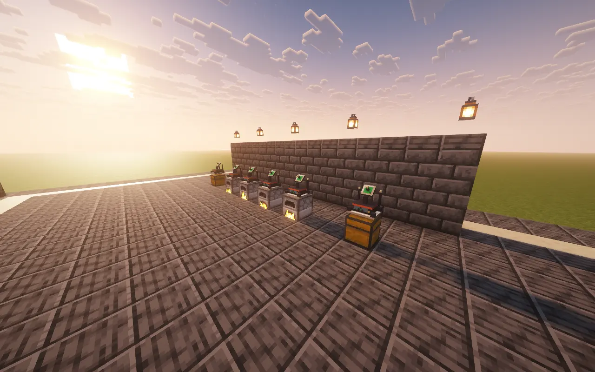
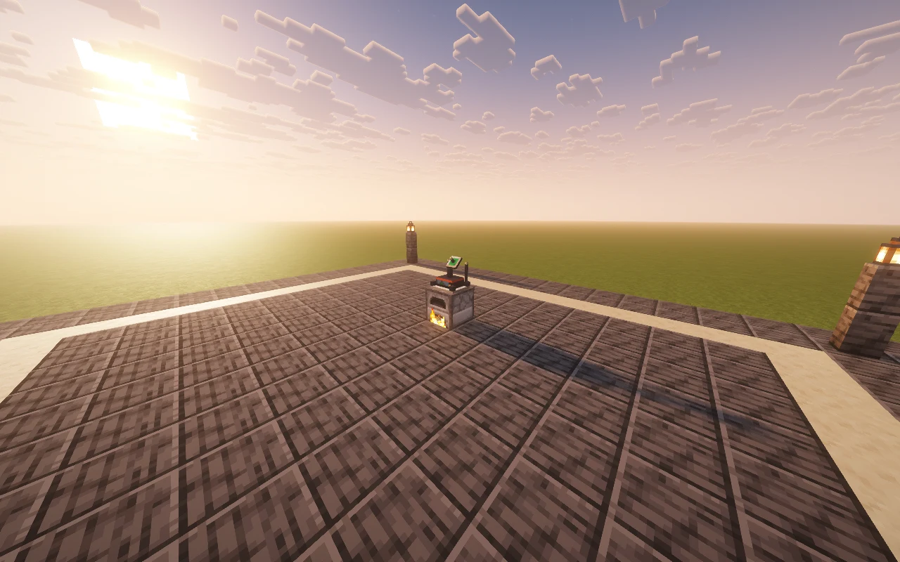
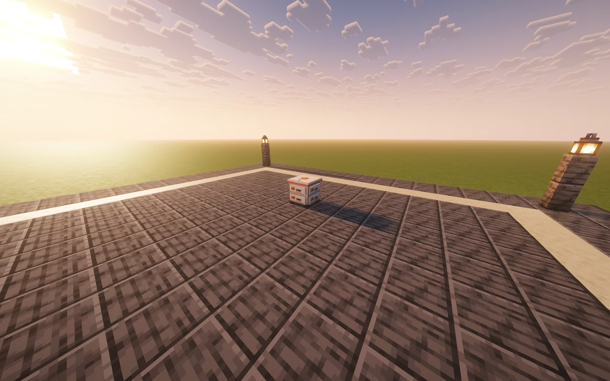
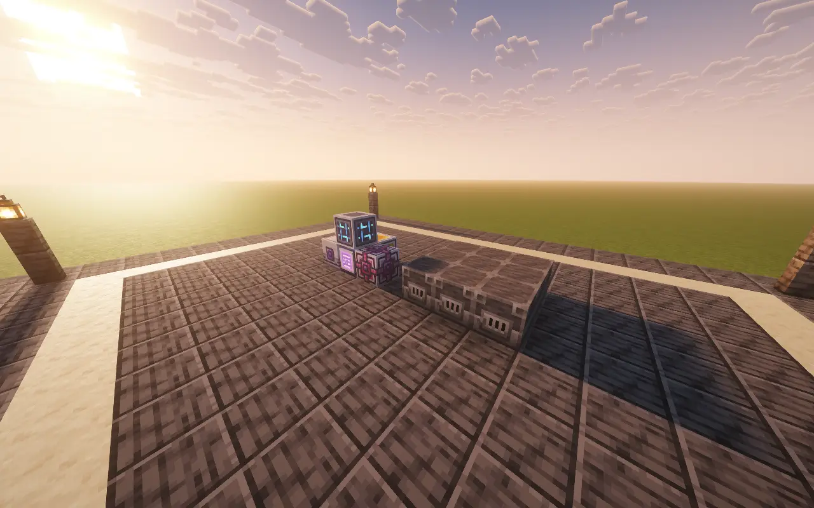
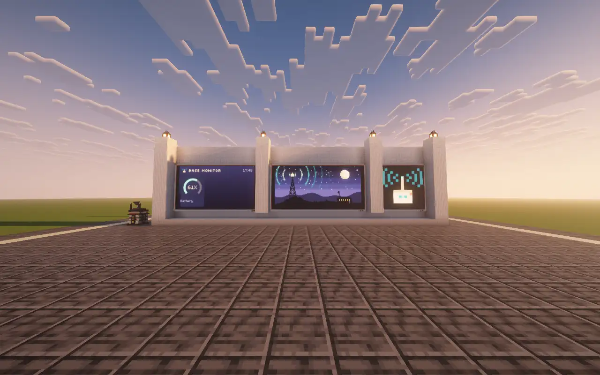
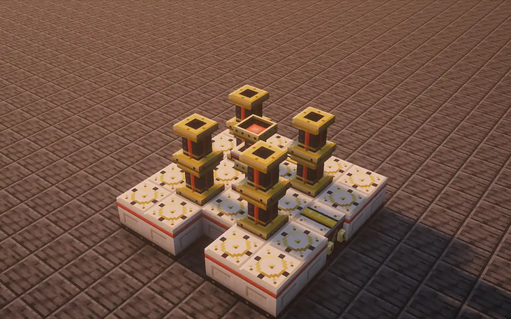
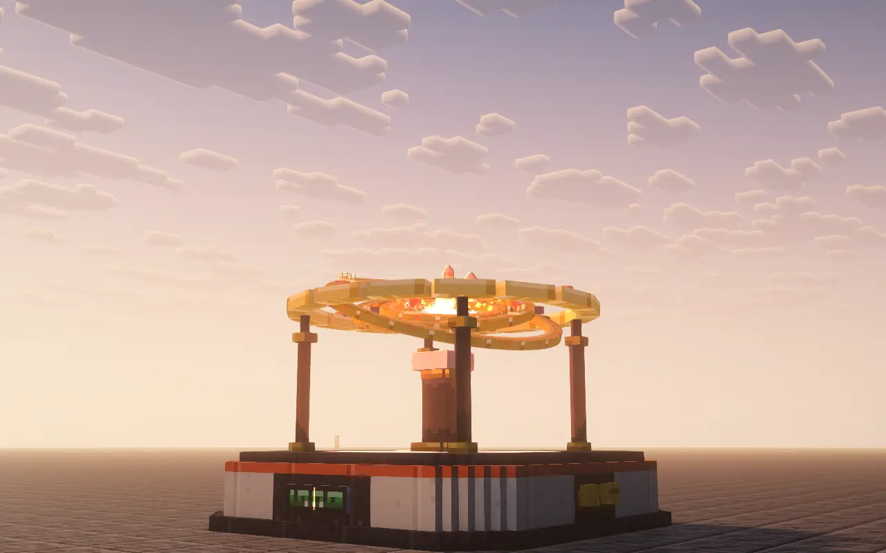
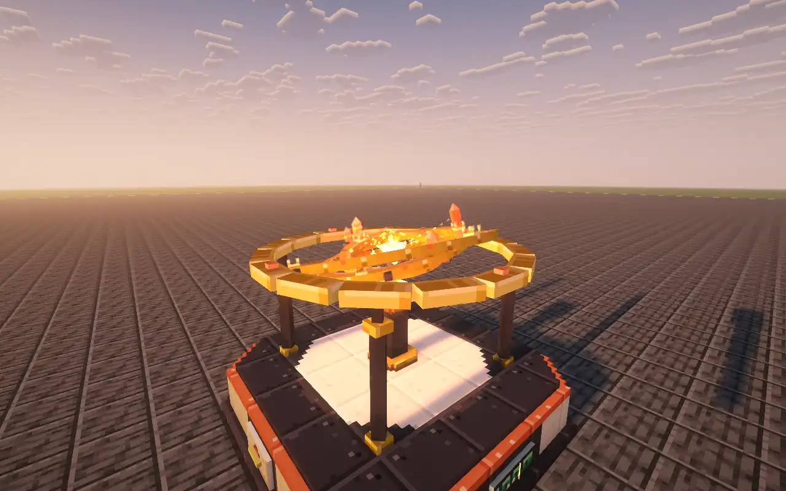
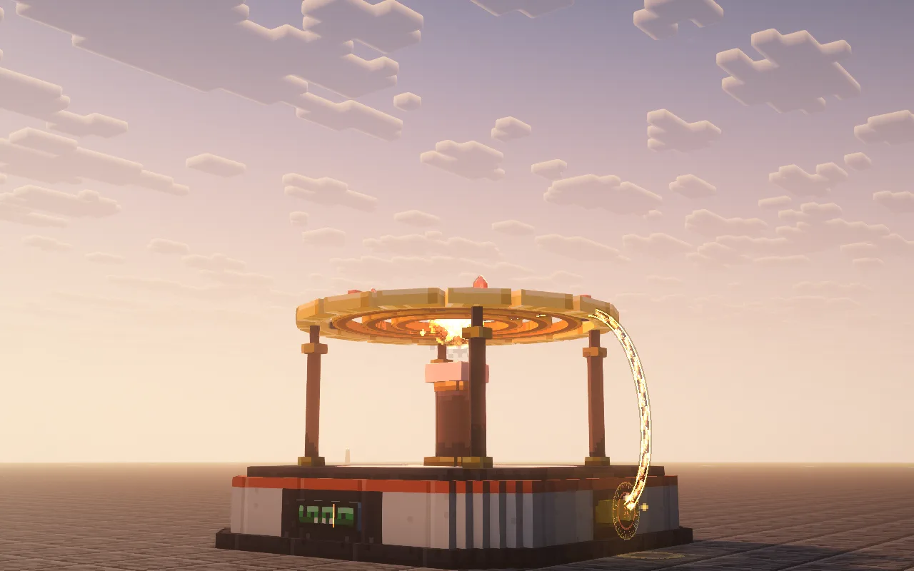

# Wireless Automate

*[Leia em português](README.md)*

**Move items, fluids, energy, Mekanism chemicals and Ars Nouveau Source between machines, without pipes.**
Attach a router to a machine, pick what each face does, and every router on the same network trades with the others, near or far, in any dimension. Built for big modpacks: one central manager with a small time budget per tick, so hundreds of machines don't turn into lag.

**Version 2.19:** the Signal Resonator becomes the Armillary, generating every tick, with an Energy Port that pushes on its own and sounds of its own. Every change is in the [changelog](docs/curseforge/changelog-curseforge-2.19.0.md). Download on [CurseForge](https://www.curseforge.com/minecraft/mc-mods/wireless-automate) or from the [latest release](https://github.com/MatheusANBS/Wireless-Automate/releases/latest).

---

## Routers



- **All six faces of the machine** from one screen, per resource type: Extract, Insert, Storage or None, with priority, round-robin and redstone.
- **A network per face:** one furnace takes ore from your mining line on top and sends ingots to storage from the bottom.
- **Range Upgrade:** one router feeds every machine you link around it, up to 128 machines on Ultimate.

## Filters



Exact items, tags and whole mods, whitelist or blacklist, with stock limits. A tag inspector, and **rules** by what an item is: any enchanted item, tools under 25% durability, Fortune ≥ III.

## Wireless Chest



Unlimited item types and billions per operation (12 million items in one tick between two of them). Two upgrade slots: a **3×3 crafting grid** that refills from the Chest and a **Compacting Upgrade** that packs nuggets → ingots → blocks as they come in. Also a Tank, a Battery and, with the optional mods, a Chemical Tank and a Source Tank.

## Pattern Dock (AE2 and Refined Storage 2)



Put an AE2 Pattern Provider or an RS2 Autocrafter against a side, link the machines with the Linker, and the Dock hands **each order whole to a free machine**, returning the result straight to the network. Items, fluids and chemicals; up to six production lines per Dock.

## Signal Screen



A wall display from 1×1 to 32×32 blocks with **live numbers** from your networks and storages, a full editor in the game, a **pixel art editor with animation**, and your own PNG, JPG and GIF files.

## Signal Resonator






A generator you tune like a radio. Build the **Armillary**, put Signal Crystals in the Core and turn the dial to the drifting station: in tune, the orrery lines up and the energy flows every tick, from 432 FE/t on Basic to **4.29 billion FE/t** on Ultimate. The Energy Port pushes into whatever touches it. Crystals wear out, crack and get mended in the **Crystal Repairer**.

---

## Tiers

| Tier | Items/s | Fluids (mB/s) | Energy (FE/t) | Range |
| --- | --- | --- | --- | --- |
| Basic | 32 | 8,000 | 454 | 64 blocks |
| Advanced | 256 | 64,000 | 29,100 | 512 blocks |
| Elite | 2,048 | 512,000 | 63,000 | Whole dimension |
| Emerald | 16,384 | 4,096,000 | 1,350,000 | Every dimension |
| Ultimate | Unlimited | Unlimited | Unlimited | Every dimension |

With **Allthemodium** (ATM10), three more tiers go between Emerald and Ultimate. Upgrade Cards raise a placed router and keep its setup. Every value is in the config.

## Also inside

**Network Tablet** (every router from anywhere, with a map and live flows) · **Linker** and **Configurator** for big builds · **Chunk Loading Upgrade** · a **guide book** with 3D scenes, in English and Portuguese · light and dark theme on every screen.

## Compatibility

Works with any block that exposes NeoForge's item, fluid and energy handlers. Optional: **Mekanism** (chemicals), **Ars Nouveau** (Source), **Allthemodium** (tiers), **AE2** and **Refined Storage 2** (Pattern Dock), **FTB Teams** (shared networks), **JEI**.

**Requires** Minecraft 1.21.1 and NeoForge 21.1.248 or newer (works with All the Mods 10).

## Source code

The source code is published for reference only (see License below). Bug reports and suggestions are welcome as [issues](https://github.com/MatheusANBS/Wireless-Automate/issues).

### Building

```bash
./scripts/setup.sh              # Linux, macOS or WSL
.\scripts\setup.ps1             # Windows (PowerShell)
```

The script installs whatever is missing (JDK 21, git, curl, unzip) and runs the first build, which downloads and decompiles Minecraft (about 4 minutes). Options: `--gametest` (`-GameTest`) also runs the GameTests; `--no-build` (`-NoBuild`) only installs the tools.

| Command | What it does |
| --- | --- |
| `./gradlew build` | Compiles, runs the JUnit tests and builds the jar in `build/libs/` |
| `./gradlew test` | JUnit tests only (logic without Minecraft) |
| `./gradlew runGameTestServer` | GameTests on a headless server (without Mekanism); fails if any test fails |
| `./gradlew runGameTestServerChemicals` | Chemical GameTests, on a server with Mekanism |
| `./gradlew runGameTestServerSource` | Source GameTests, on a server with Ars Nouveau (plus GeckoLib and Curios) |
| `./gradlew runGameTestServerAllthemodium` | ATM tier GameTests, with Allthemodium, All The Tweaks and GeckoLib |
| `./gradlew runGameTestServerTeams` | Team GameTests, on a server with FTB Teams, FTB Library and Architectury |
| `./gradlew runClient` | Dev client with JEI, Mekanism, Ars Nouveau, Allthemodium and other mods, for manual testing |
| `./gradlew runData` | Data generators, output in `src/generated/resources/` |
| `./scripts/e2e.sh` | End-to-end test in a real world (see `docs/e2e.md`) |
| `./scripts/bench.sh <scenarios>` | Benchmark on a dedicated server with Sophisticated Storage (see `docs/benchmark.md`) |

CI (`.github/workflows/build.yml`) runs `build` and the five GameTest runs on every push and pull request.

### Layout

The source code map is in [`CLAUDE.md`](CLAUDE.md) ("Mapa do código"). The project docs are in Portuguese.

- `docs/especificacao.md`: the mod's specification (the source of truth for the design).
- `docs/progresso/`: what's done, what's left, the decisions and the history.
- `docs/benchmark.md`: how to run the benchmark, and the results.
- `docs/curseforge/`: the CurseForge description, changelogs and the GIFs used here.
- `scripts/`: `setup.sh`/`setup.ps1`, `e2e.sh`, `bench.sh`, `textures/` (generates the textures), `guide/` (generates the guide pages) and `curseforge/` (builds the CurseForge GIFs).

## License

All Rights Reserved: the code and assets are here for reference only, with no permission to copy, modify or redistribute them (see [`LICENSE`](LICENSE)). For suggestions and bugs, open an issue.
