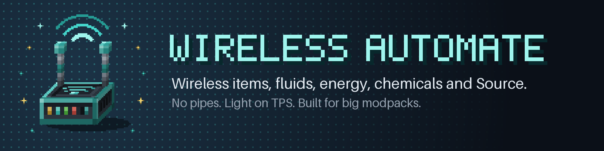

*[Read in English](README.en.md)*

O **Wireless Automate** move itens, fluidos, energia, químicos do Mekanism e Source do Ars Nouveau entre máquinas **sem canos**. Prenda um roteador numa máquina, escolha o que cada face da máquina faz, e todos os roteadores da mesma rede trocam entre si, perto ou longe. Ele também traz **armazenamentos próprios** que movem bilhões por operação, filtros que pegam tags com um clique ou casam **qualquer item encantado**, e um gerador de cristal que você sintoniza como um rádio, o **Ressonador de Sinal**.

Foi feito para modpacks grandes: em vez de cada bloco ter o próprio tick, um gerenciador central move tudo dentro de um orçamento de tempo pequeno por tick, então centenas de máquinas não viram lag.

**Estado:** versão 2.13. O Baú Wireless ganha dois slots de upgrade: o **Upgrade de Mesa de Trabalho** (uma grade 3×3 dentro do Baú, que se repõe pelo estoque dele) e o **Upgrade de Compactação** (cadeias de itens como pepita, lingote e bloco compactadas e descompactadas sozinhas). O que mudou em cada versão está no [changelog](docs/curseforge/changelog-curseforge-2.13.0.md) e na [página de releases](https://github.com/MatheusANBS/Wireless-Automate/releases).

Baixe no [CurseForge](https://www.curseforge.com/minecraft/mc-mods/wireless-automate) ou na [release mais recente do GitHub](https://github.com/MatheusANBS/Wireless-Automate/releases/latest). Requer NeoForge 21.1.248 ou mais novo (roda no ATM10).

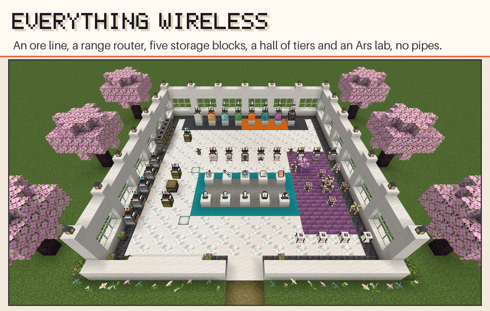

---

## Recursos

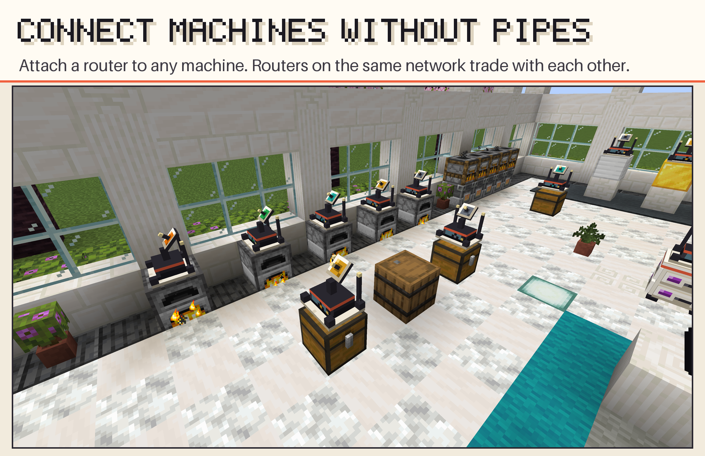

- **Um roteador por máquina.** Prenda-o em qualquer face de qualquer bloco. Pela tela dele você configura **as seis faces da máquina**, não só aquela em que ele está. Shift + clique direito com as mãos vazias gira o roteador para qualquer lado; a configuração de cada face fica onde está.
- **Redes, não cabos.** Roteadores na mesma rede trocam recursos do mesmo tipo (itens, fluidos, energia e, com os mods opcionais, químicos e Source). **Cada face da máquina entra na sua própria rede**, por tipo de recurso, então uma fornalha pode tirar minério da linha da mina por cima e mandar lingotes para o armazém por baixo, enquanto a energia vem da rede da base.
- **Um roteador, várias máquinas:** com o **Upgrade de Alcance**, um roteador só atende todas as máquinas que você vincula em volta dele, então uma farm inteira se configura uma vez (veja Upgrade de Alcance abaixo).
- **Quatro modos por face:** Extrai, Insere, Armazém (um buffer que recebe de quem extrai e entrega para quem insere) ou Nenhum.
- **Prioridade, round-robin e controle por redstone** em cada face e cada tipo de recurso.
- **Telas redimensionáveis:** o roteador, o Tablet de Rede e o Vinculador mudam de tamanho pela borda e pelo canto, e as abas do roteador se adaptam à largura.
- **Tema claro e escuro:** toda tela tem os dois; troque pelo botão lua/sol do cabeçalho.

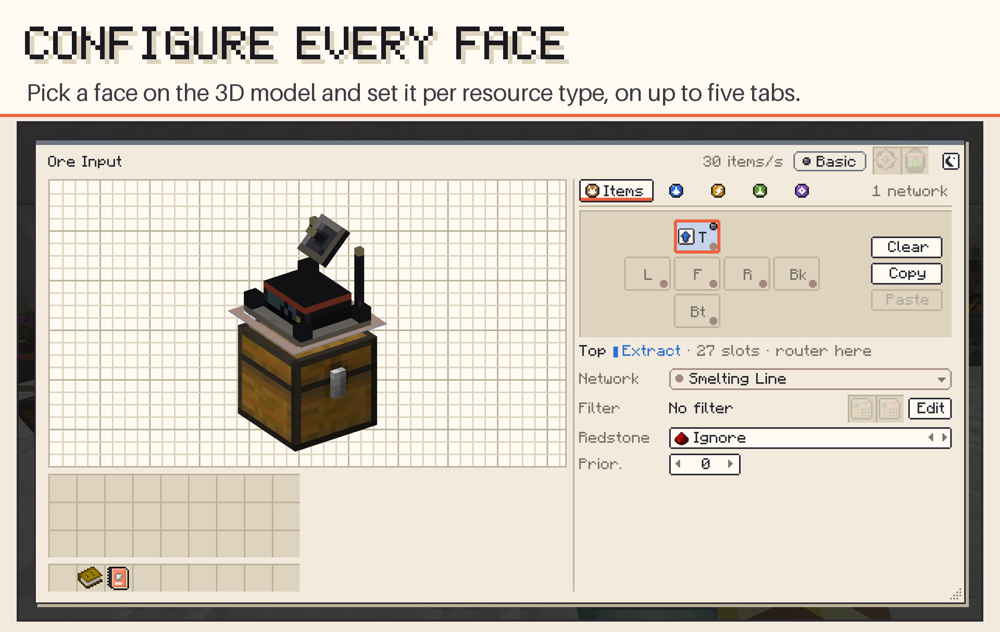

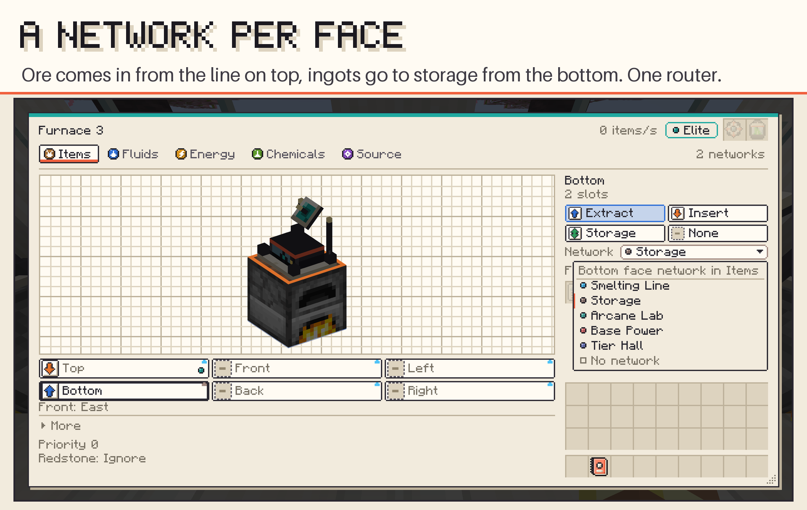

### Upgrade de Alcance

Um roteador move de e para todas as máquinas que você vincula no raio dele (6 blocos e 8 máquinas no Avançado, até 64 blocos e 128 máquinas no Ultimate). Máquinas vinculadas do mesmo bloco formam um grupo com um perfil, com exceções por máquina, e os lados seguem a frente de cada máquina. As máquinas acordam o roteador assim que mudam, e nada varre o mundo enquanto ele roda. Máquinas vinculadas começam sem rede: escolha a rede de cada face explicitamente na linha Rede do painel. Trocar a ação da face mantém a rede dela. **Tirar redes** tira a rede de todas as faces com Nenhum, com Desfazer. Dê nomes às máquinas e aos grupos, e acenda qualquer máquina **no mundo**, através dos blocos, com uma linha até o roteador; clique direito numa máquina com o Tablet de Rede vai direto para ela.

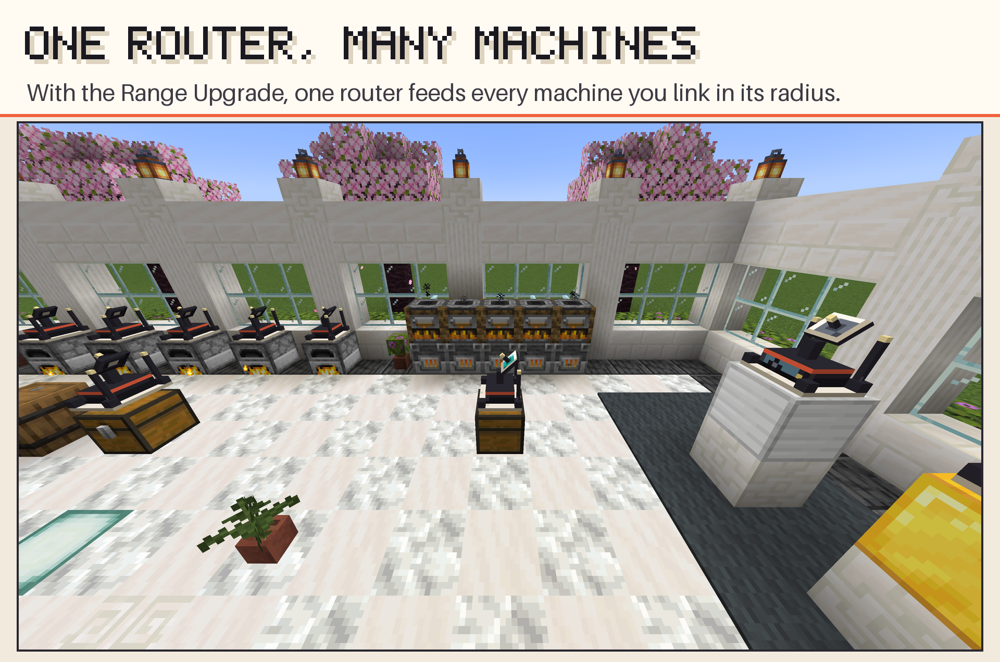

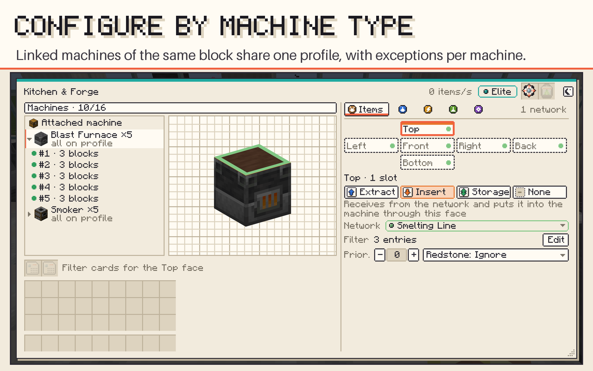

### Filtros sem limite de entradas

Itens exatos, tags (`#c:ores`) e mods inteiros (`@mekanism`), em lista branca ou negra, com **limites de estoque** ("manter 64 na origem", "aceitar até 16 no destino"). Acrescente entradas com Shift + clique no seu inventário ou arrastando do **JEI**. Os Cartões de Filtro levam um filtro inteiro para reusar em outras faces.

- **Inspetor de tags:** ponha qualquer item no inspetor e todas as tags dele aparecem, prontas para marcar e acrescentar. Ou busque em todas as tags do jogo, com quantos itens cada uma casa e uma prévia.
- Uma janela redimensionável, com as entradas numa lista com busca.

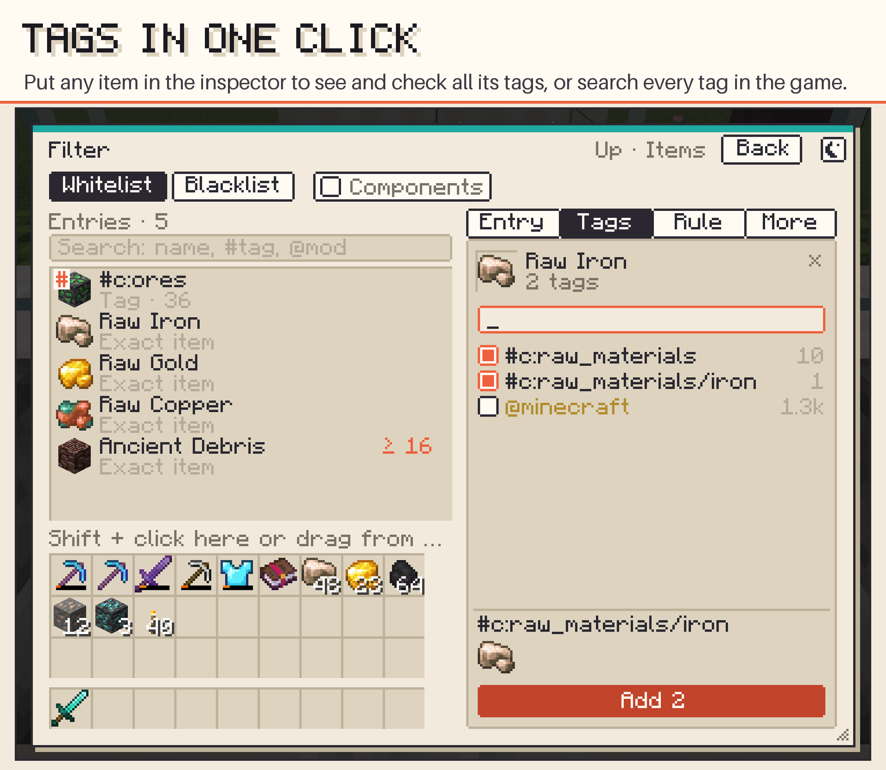

### Regras por propriedade

Pegue itens pelo que eles **são**, não por qual item são: **qualquer item encantado**, danificado ou intacto, renomeado, poções, não empilháveis, caixas de shulker com conteúdo, um encantamento com nível mínimo (digite o nome e escolha nas sugestões, qualquer nível de 1 a 255: Fortuna ≥ III, Eficiência ≥ 37) ou a durabilidade restante (mande para o reparo as ferramentas abaixo de 25%). Limite uma regra a uma tag ou mod: Encantado + `#c:armors` = só armadura encantada. O seu inventário acende no que a regra casa antes de você acrescentá-la.

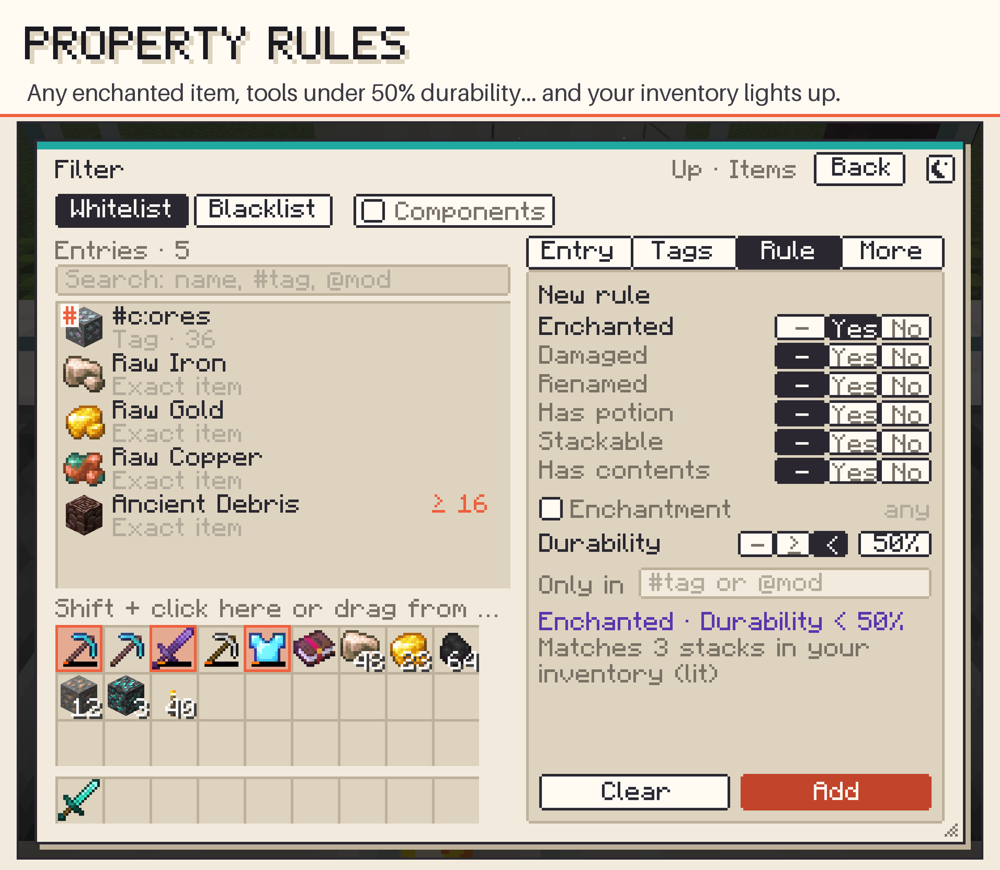

### Cinco tiers, oito com o Allthemodium

Os tiers sobem a vazão e o alcance do roteador pela escada Básico → Avançado → Elite → **Esmeralda** → Ultimate. Com o mod **Allthemodium** (ATM10), mais três degraus entram entre a Esmeralda e o Ultimate: **Allthemodium → Vibranium → Unobtainium**, feitos com os metais do próprio mod, e no ATM10 o anel do Ultimate pede **fragmentos de ATM Star**. Cada tier tem um anel de ingredientes, usado de dois jeitos pelo mesmo custo: ponha um roteador (ou armazenamento) no centro do anel seguinte na bancada, ou faça um Cartão de Upgrade ("Básico → Elite") e use no roteador colocado, que mantém toda a configuração. Um cartão pode pular tiers: ponha-o no centro do anel seguinte para estendê-lo.

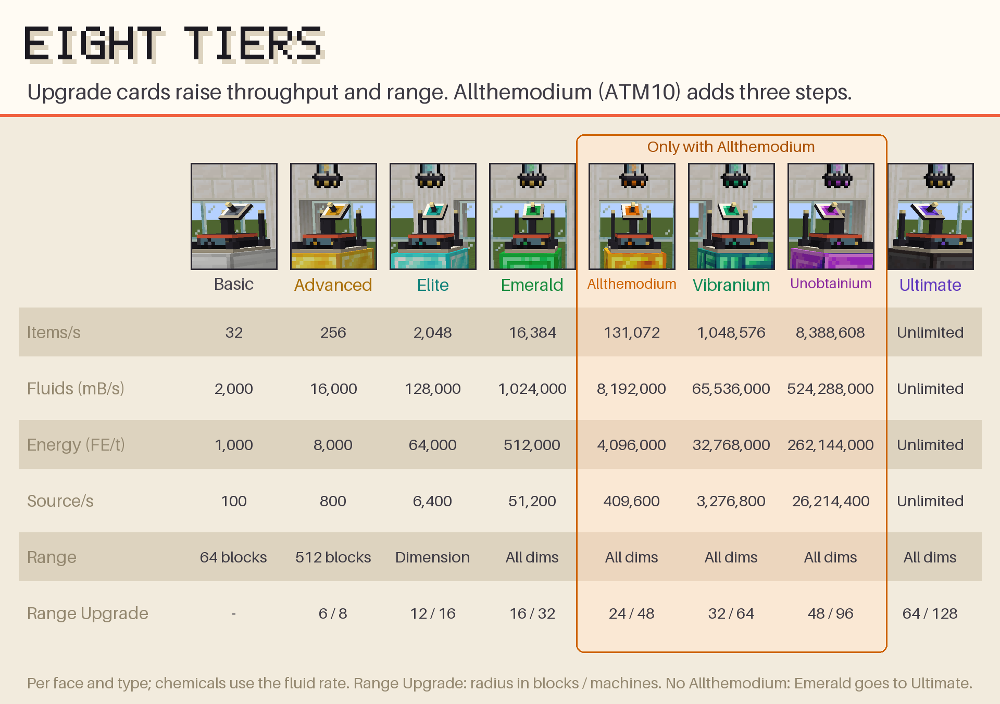

| Tier | Itens/s | Fluido e químico (mB/s) | Energia (FE/t) | Source/s | Alcance | Upgrade de Alcance |
| --- | --- | --- | --- | --- | --- | --- |
| Básico | 32 | 2.000 | 454 | 100 | 64 blocos | — |
| Avançado | 256 | 16.000 | 29.100 | 800 | 512 blocos | 6 blocos, 8 máquinas |
| Elite | 2.048 | 128.000 | 63.000 | 6.400 | Dimensão inteira | 12 blocos, 16 máquinas |
| Esmeralda | 16.384 | 1.024.000 | 1.350.000 | 51.200 | Todas as dimensões | 16 blocos, 32 máquinas |
| Allthemodium¹ | 131.072 | 8.192.000 | 67.200.000 | 409.600 | Todas as dimensões | 24 blocos, 48 máquinas |
| Vibranium¹ | 1.048.576 | 65.536.000 | 84.500.000 | 3.276.800 | Todas as dimensões | 32 blocos, 64 máquinas |
| Unobtainium¹ | 8.388.608 | 524.288.000 | 158.000.000 | 26.214.400 | Todas as dimensões | 48 blocos, 96 máquinas |
| Ultimate | Sem limite | Sem limite | Sem limite | Sem limite | Todas as dimensões | 64 blocos, 128 máquinas |

*Por face e por tipo de recurso; cada máquina vinculada pelo Upgrade de Alcance tem a vazão cheia, e a energia de cada tier escoa a geração cheia do Ressonador de Sinal do mesmo tier. ¹ Só com o Allthemodium. Donos de servidor podem mudar todos os valores na config.*

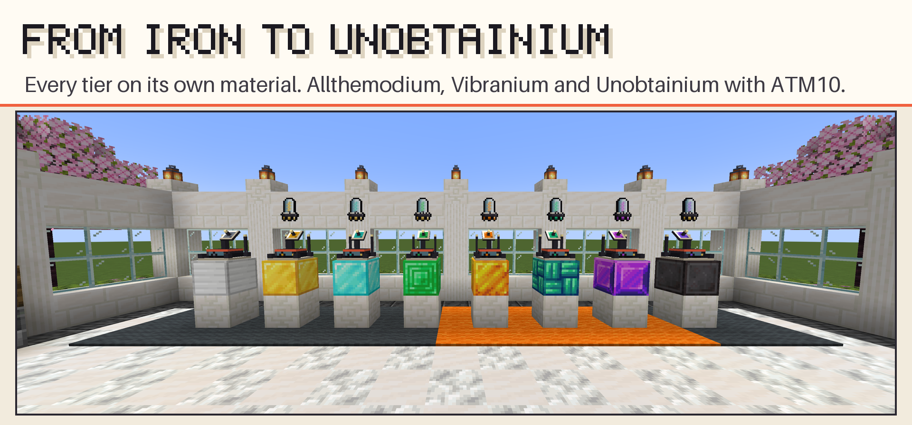

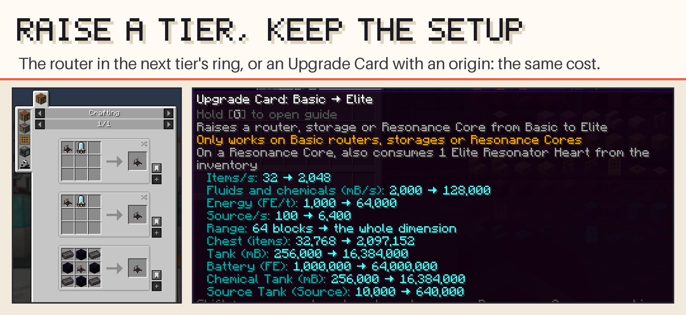

### Armazenamento wireless

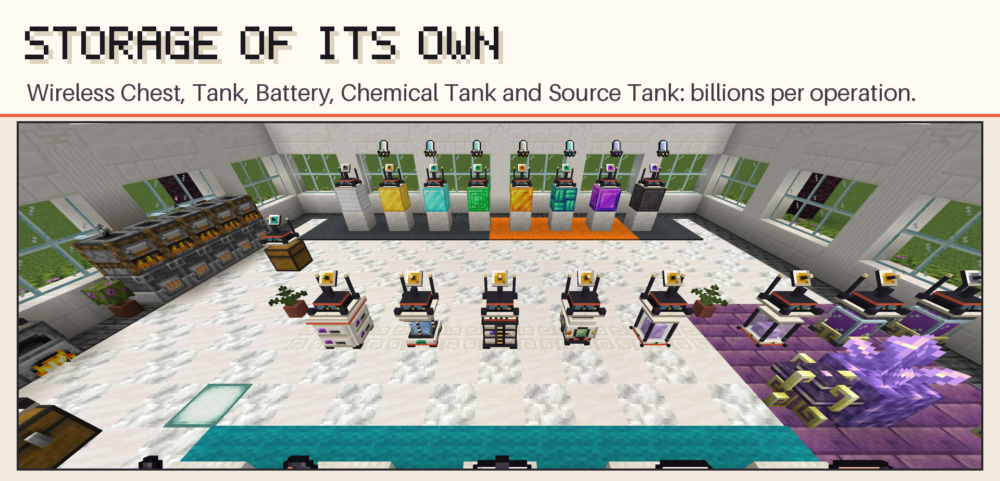

Cinco armazenamentos feitos para o roteador: o **Baú Wireless** (tipos de item ilimitados, sem slots), o **Tanque Wireless**, a **Bateria Wireless** e, com os mods opcionais, o **Tanque Químico Wireless** (Mekanism) e o **Tanque de Source Wireless** (Ars Nouveau). Entre dois deles, um roteador move um tipo de item inteiro numa operação só (**12 milhões de itens em um tick**) e fluidos e energia aos bilhões. Para todos os outros mods eles são um inventário, tanque ou bateria comum, e o Baú enche slots de pilha grande (upgrades de pilha do Sophisticated Storage, gavetas) um slot inteiro por inserção: **2,1 bilhões de itens num barril com o Upgrade Ômega em um tick**.

| Tier | Baú (itens) | Tanque e Tanque Químico | Bateria | Tanque de Source |
| --- | --- | --- | --- | --- |
| Básico | 32.768 | 256 B | 31,1M FE | 10.000 |
| Avançado | 262.144 | 2.048 B | 1,99G FE | 80.000 |
| Elite | 2.097.152 | 16.384 B | 4,32G FE | 640.000 |
| Esmeralda | 16.777.216 | 131.072 B | 92,2G FE | 5.120.000 |
| Allthemodium¹ | 134.217.728 | 1.048.576 B | 4,61T FE | 40.960.000 |
| Vibranium¹ | 1.073.741.824 | 8.388.608 B | 5,79T FE | 327.680.000 |
| Unobtainium¹ | 8.589.934.592 | 67.108.864 B | 10,8T FE | 2.621.440.000 |
| Ultimate | Sem limite | Sem limite | Sem limite | Sem limite |

- Uma Bateria guarda **uma hora do Ressonador de Sinal do tier dela** em geração cheia, e a vazão de energia de um roteador é a geração desse mesmo Ressonador mais 5% (Ultimate: sem limite).
- Sobem com os mesmos anéis e Cartões de Upgrade do roteador, sem perder o conteúdo.
- **Quebrou, o conteúdo vai no item**, como numa caixa de shulker, com o tier junto.
- Tela com busca, ordenação e redimensionável; um filtro de entrada decide o que pode entrar, por qualquer caminho; sinal de comparador.
- Controles no estilo do Mouse Tweaks na lista do Baú: Shift + arrastar, rodinha do mouse para mover um item por vez e Shift + duplo clique (com um item no cursor) para encher o inventário.
- Busque na lista do Baú pelo nome, por `@mod`, ou por `#` em tags e no texto do tooltip (`#ingots`, `#not yet eaten`). Segure Shift e a lista para de se reordenar enquanto você tira itens, como no terminal do AE2.

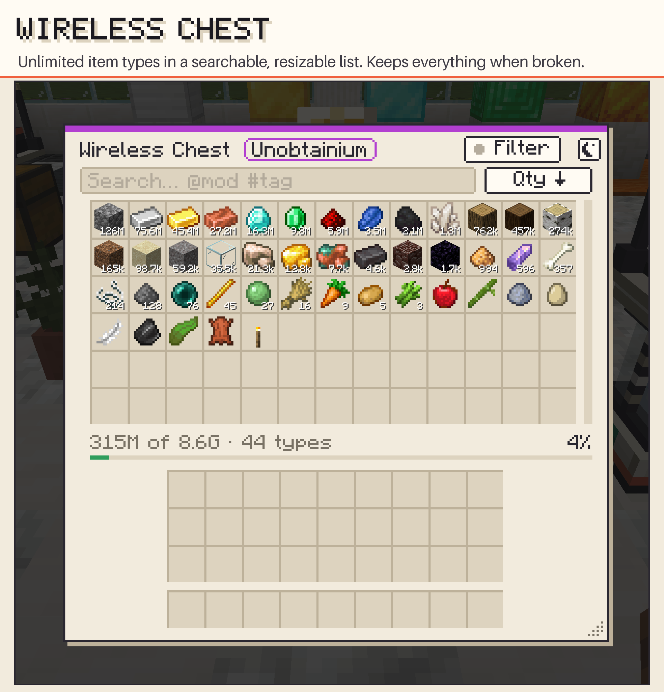

### Upgrades do Baú

O Baú Wireless tem dois slots de upgrade, ao lado da lista. Cada upgrade abre o próprio painel ao lado da lista.

- **Upgrade de Mesa de Trabalho:** uma grade de fabricação 3×3 dentro do Baú, que se repõe sozinha com o estoque dele. Shift + clique no resultado fabrica até uma pilha; o **+** do JEI enche a grade com o Baú primeiro.

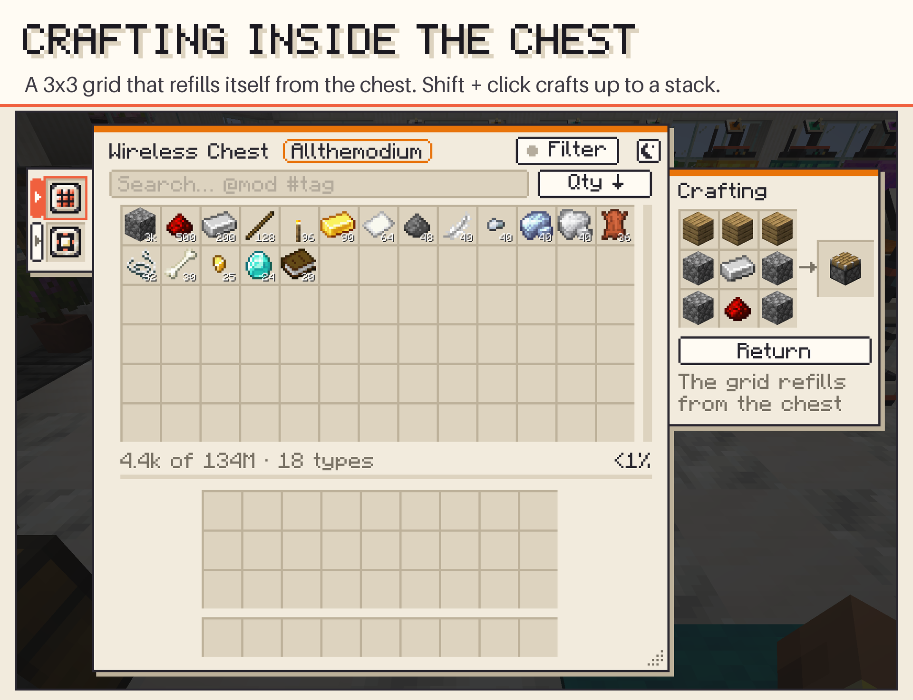

- **Upgrade de Compactação:** compacta e descompacta sozinho as cadeias de itens conforme elas entram: pepita, lingote, bloco, ou pedregulho até o 9x do AllTheCompressed. Escolha um modo para todas as cadeias (**Compactar** ou **Descompactar**) ou uma forma alvo para uma cadeia só. O mesmo material de mods diferentes é uma linha só, e um botão escolhe para os itens de qual mod vai tudo.

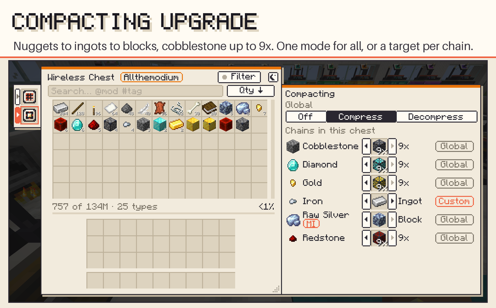

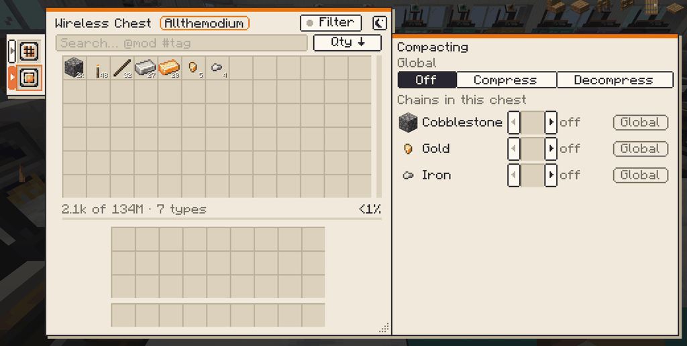

### Source do Ars Nouveau

Com o Ars Nouveau instalado, todo roteador ganha uma aba **Source**. Source Jars, Relays e a Imbuement Chamber se ligam direto num roteador, então a Source viaja sem fio entre eles como qualquer outro recurso, na Source/s do tier do roteador.

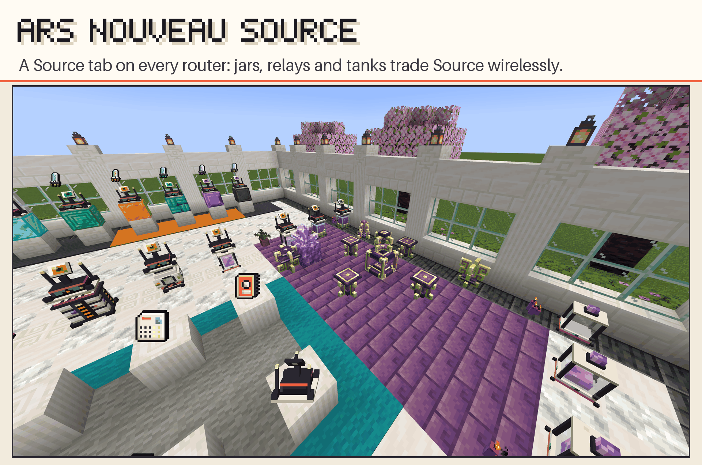

O **Tanque de Source Wireless** guarda de 10.000 de Source (Básico) a sem limite (Ultimate) e mostra o nível no vidro. Sourcelinks a até 5 blocos depositam nele e as máquinas do Ars por perto tiram dele, como de uma Source Jar.

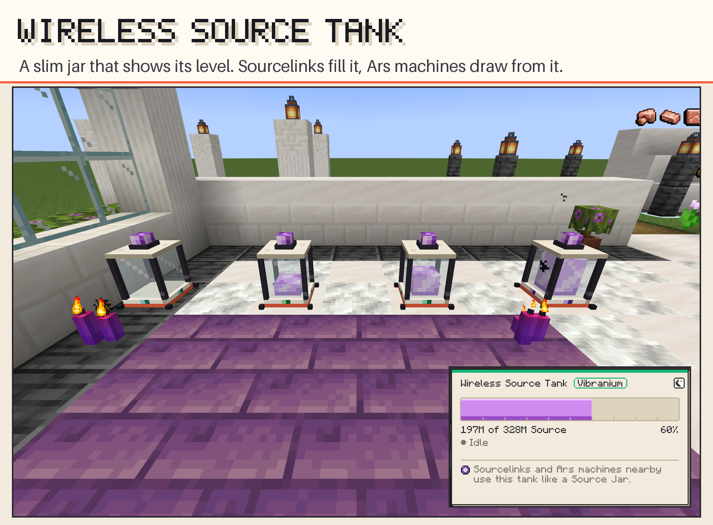

### Ressonador de Sinal

Um gerador multibloco que transforma cristais de quartzo vibrando em FE. Minere o **Quartzo de Sinal** (Overworld, pedra e ardósia), monte uma caixa oca 5×5×5 em volta de um **Núcleo de Ressonância** e ponha **Cristais de Sinal** nas câmaras dele. Cada Ressonador tem a sua **estação**, uma frequência que escorrega devagar: gire o dial até a lâmpada dizer **EM SINTONIA** para 100%, ou ponha um **Sintonizador** para seguir a estação sozinho, um pouco abaixo do topo. Fora da estação, não gera nada.

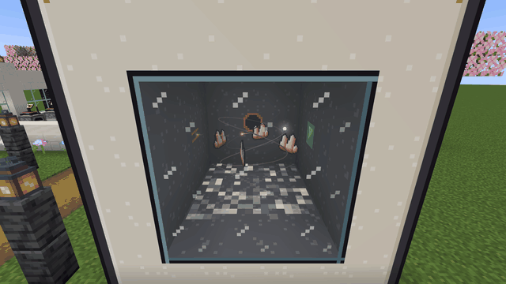

Pelo vidro dá para ler a sintonia: o Núcleo de plasma com o anel do tier dele, os cristais orbitando, cada um vivo alimentando o Núcleo por um tentáculo de plasma que fica grosso e firme em sintonia e afina e se solta fora dela, e um raio de energia até cada porta que está entregando. Cristais gastos ficam **Opacos** e recarregam dentro do Núcleo com um catalisador (redstone ou Pó de Ressonância nos primeiros tiers, o Pó Carregado do tier do Allthemodium para cima). A energia sai pela **Porta de Energia**, direto num roteador.

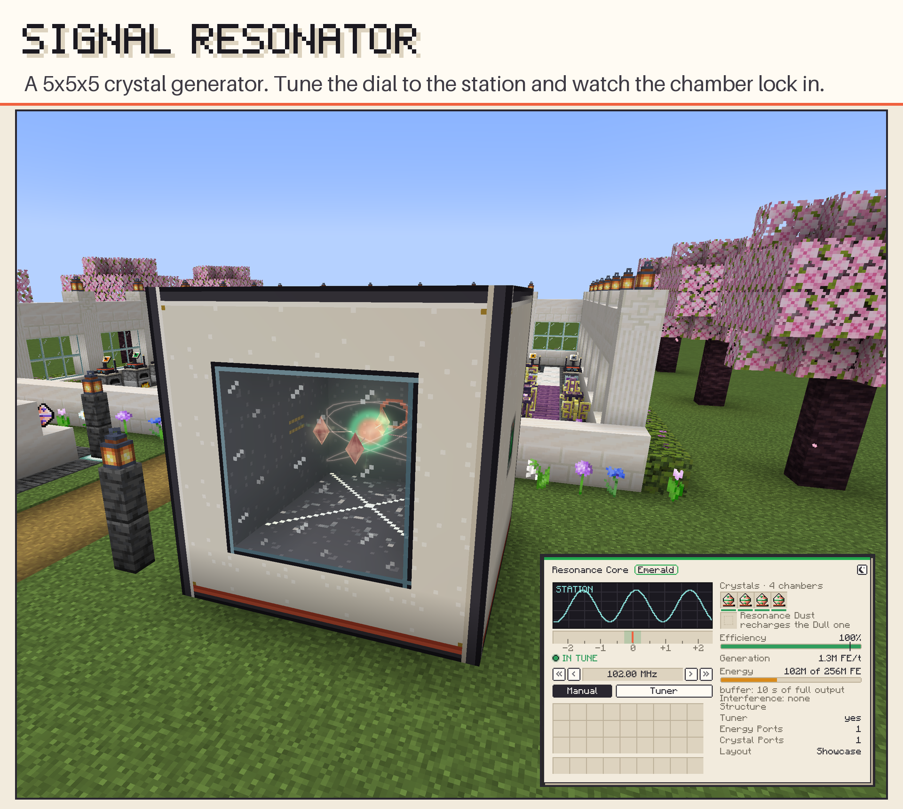

| Tier do Núcleo | Câmaras | FE/t por cristal | Teto do Sintonizador |
| --- | --- | --- | --- |
| Básico | 1 | 216 | 85% |
| Avançado | 2 | 6.912 | 88% |
| Elite | 3 | 10.000 | 90% |
| Esmeralda | 4 | 160.000 | 92% |
| Allthemodium¹ | 5 | 6.400.000 | 94% |
| Vibranium¹ | 6 | 6.700.000 | 95% |
| Unobtainium¹ | 7 | 10.700.000 | 96% |
| Ultimate | 8 | 268.435.456 | 98% |

*¹ Só com o Allthemodium. Donos de servidor podem mudar o FE por cristal na config.*

Um Cristal Lapidado rende o dobro e dura o dobro. Do Elite para cima, cada câmara pede o **Cristal Afinado** do tier do Núcleo (um cristal comum rende 1/4 ali, um Lapidado 1/2): com os Afinados do tier em todas as câmaras, o Ressonador supera o melhor gerador do tier dele, de 432 FE/t no Básico a 4,29 bilhões de FE/t no Ultimate. E custa à altura: todo cristal tem **8 cargas de integridade** e depois racha, refeito na bancada com 4 Cristais de Sinal; outro Núcleo montado a até 32 blocos tira 15% da eficiência (até 60%); e o Núcleo Ultimate queima Cristais Afinados Ultimate rachados como **Eco Ressonante**, +5% permanente cada, sem teto. O Núcleo é feito com o **Coração do Ressonador** do tier dele, que sai de uma cascata de 11 componentes (Liga de Sinal, placas, bobinas, lentes, circuitos e matrizes de fase, estabilizadores de campo, núcleos condensados), e subir o Núcleo de tier pede o Coração seguinte junto com o Cartão de Upgrade. O JEI mostra a estrutura em 3D e todas as receitas, e o livro-guia explica cada passo.

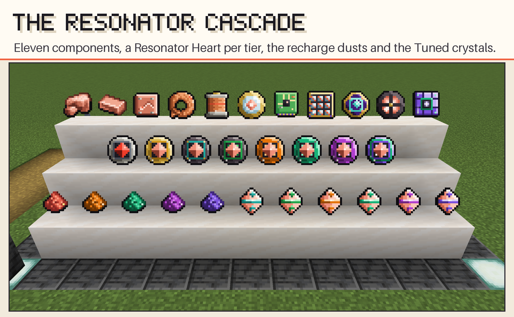

### Reparador de Cristais

Um cristal rachado não é mais uma ida à bancada. Ponha-o num dos **8 pedestais** do Reparador de Cristais e ele o conserta, **até oito cristais em paralelo**. Cada reparo leva 7 segundos e gasta **4 Cristais de Sinal cheios** do slot de estoque comum mais energia: 2 vezes o FE por cristal do tier do cristal (432 FE para um Cristal de Sinal, 13.824 FE para um Lapidado e o preço do próprio tier para um Afinado). O cristal sai pelos slots de saída com a carga e a integridade cheias.

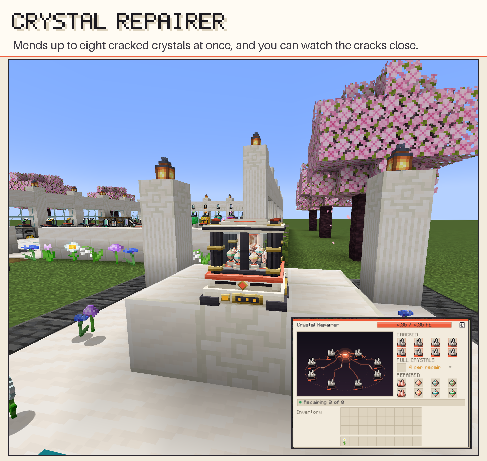

Energia e itens entram por qualquer lado, então um roteador o mantém abastecido. As rachaduras fecham de dentro para fora, os cristais convergem para o emissor e o consertado sobe. O Núcleo do Ressonador também ficou mais rápido na outra ponta: agora recarrega **todos os cristais Opacos que o catalisador paga de uma vez**. Receita: Carcaça de Porcelana, Circuito de Fase, Funil, Lente Harmônica e um Bloco de Redstone. O tempo e o custo do reparo ficam na config (`repairer.repairTicks` e `repairer.costFactor`).

### Tela de Sinal

Um painel de parede que mostra **números ao vivo das suas redes e armazenamentos**. Grude-a na lateral de um bloco sólido e estique de **1 × 1 a 32 × 32 blocos** na aba Tamanho: sem blocos extras, a imagem cobre a parede inteira.

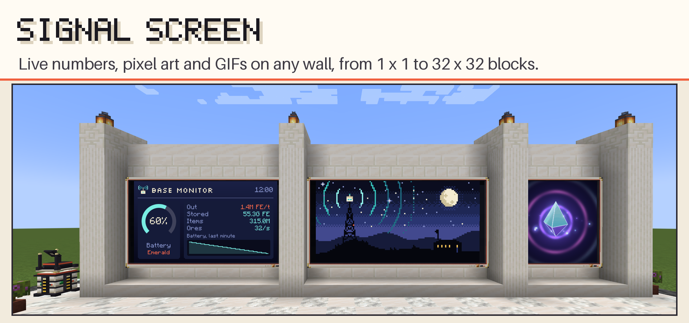

- **Um editor completo no jogo:** arraste, redimensione, agrupe e empilhe peças, copie e cole entre Telas, desfaça até 100 passos. Peças: **Valor, Texto, Forma, Ícone, Barra, Medidor, Gráfico e Seta**, cada uma alimentada por uma **rede**, um **armazenamento ligado** ou o **relógio do jogo**.
- **Regras** mudam a cor de uma peça, o fundo, fazem piscar ou esconder quando um número está abaixo, acima ou igual a um valor. Cinco fontes, quatro temas prontos (Grafite, Fósforo, Âmbar, Porcelana) mais os seus, fundos, scanlines.
- **Layouts prontos** para a Tela inteira (Energia, Armazenamento, Rede, Relógio) que se ajustam a qualquer tamanho, **layouts que você mesmo salva** e **componentes** prontos ou seus, escolhidos numa lista com um clique.
- O **Ícone** mostra **qualquer item, fluido ou químico do Mekanism** arrastado do JEI, até itens com dados (gemas do Apotheosis, equipamento encantado), em 3D e com ícones animados.
- **Ligue armazenamentos com o Vinculador** (modo Tela): clique na Tela, depois num Baú, Bateria ou Tanque Wireless, a qualquer distância e em qualquer dimensão. Um armazenamento num chunk descarregado mostra o último número, marcado como desatualizado; chunks nunca são carregados à força.
- **Barata:** nada roda enquanto ninguém está perto; o cliente redesenha uma Tela só quando um número ou o layout muda, dentro de um orçamento de memória de vídeo.

**Pixel art, animações, imagens e GIFs.**

- **Um editor de pixel art no jogo**, de 8 × 8 a **128 × 128** com uma **paleta de 16 cores**: lápis, borracha, balde, linha, retângulo, elipse, sombra, dither e seleção, pincéis até 8 px, espelhos, virar e girar, **Criar rampa** a partir de qualquer cor e 100 passos de desfazer. As suas artes ficam na sua biblioteca (32 por padrão) e vão para uma Tela como peça **Imagem**, em qualquer escala inteira, ou como fundo em mosaico.

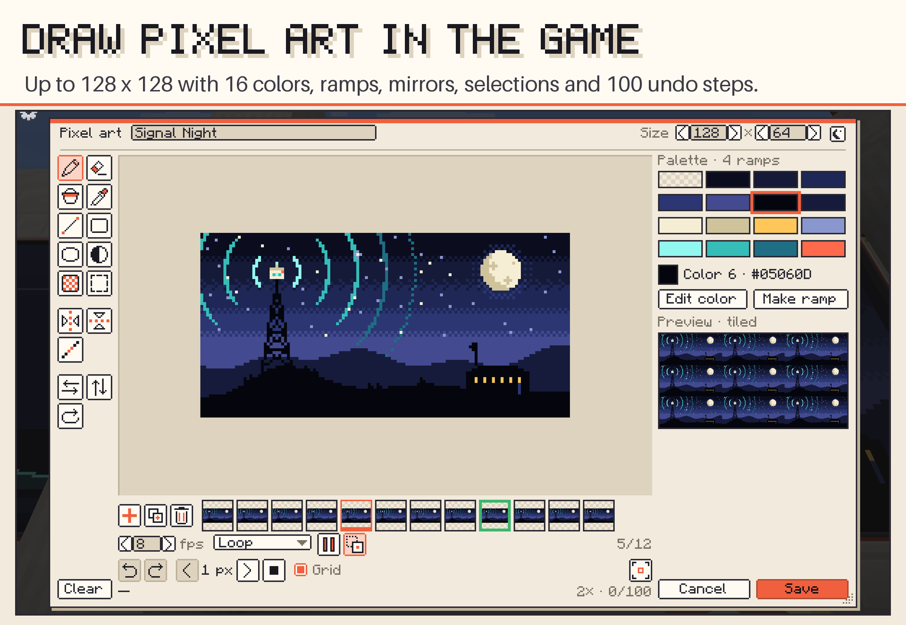

- **Anime quadro a quadro:** até **64 quadros** por arte, de **1 a 20 quadros por segundo**, em loop ou indo e voltando, com uma faixa de quadros e papel vegetal. Duas Telas com a mesma arte tocam juntas.

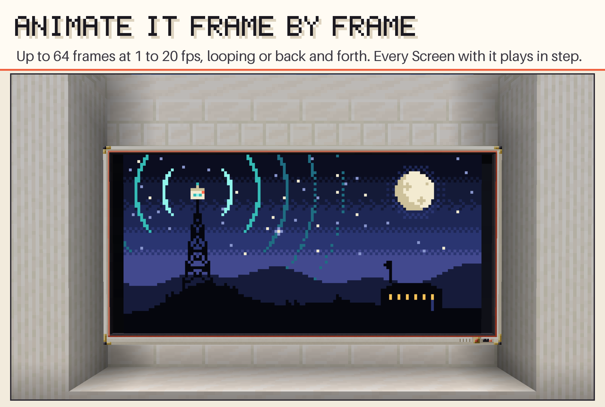

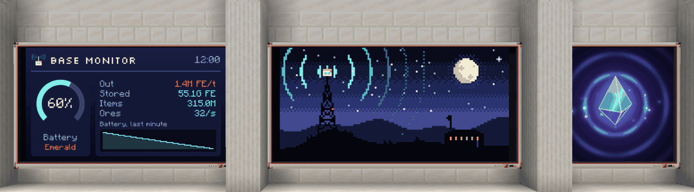

- **Imagens e GIFs de verdade:** **Enviar arquivo** manda um **PNG, JPG ou GIF** do seu computador (nunca um link), até **1024 px** e **8 MB** por arquivo e 240 quadros por GIF por padrão, e GIFs animados tocam na Tela. Donos de servidor podem desligar as imagens, deixar só operadores enviarem, mudar todos os limites e, com `/wa screen`, tirar uma imagem de todas as Telas ou impedir um jogador de enviar; cada jogador pode esconder as imagens enviadas pelos outros na config do cliente (`showOthersImages`).

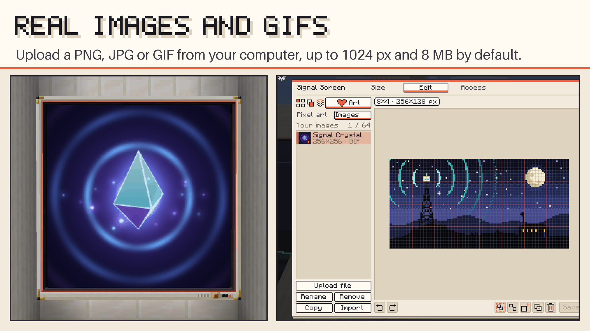

- **Exportar e importar como texto:** artes, imagens e layouts inteiros se copiam como um código curto ou como texto legível, então você pode compartilhar uma Tela ou deixar uma IA de chat desenhar por você: cole o [guia de pixel art para IAs](docs/guia-pixel-art-com-ia.md) no chat, peça um desenho e importe a resposta.
- **Acesso:** na aba Acesso, convide jogadores ou, com o FTB Teams, times inteiros para editar uma Tela como o dono (tamanho, layout e ligações). Qualquer um continua podendo olhar.

### Ferramentas para construções grandes

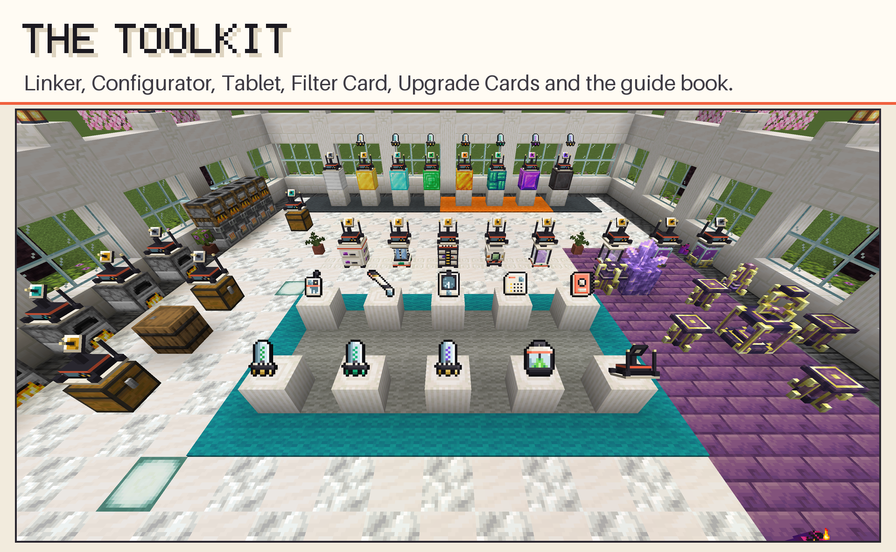

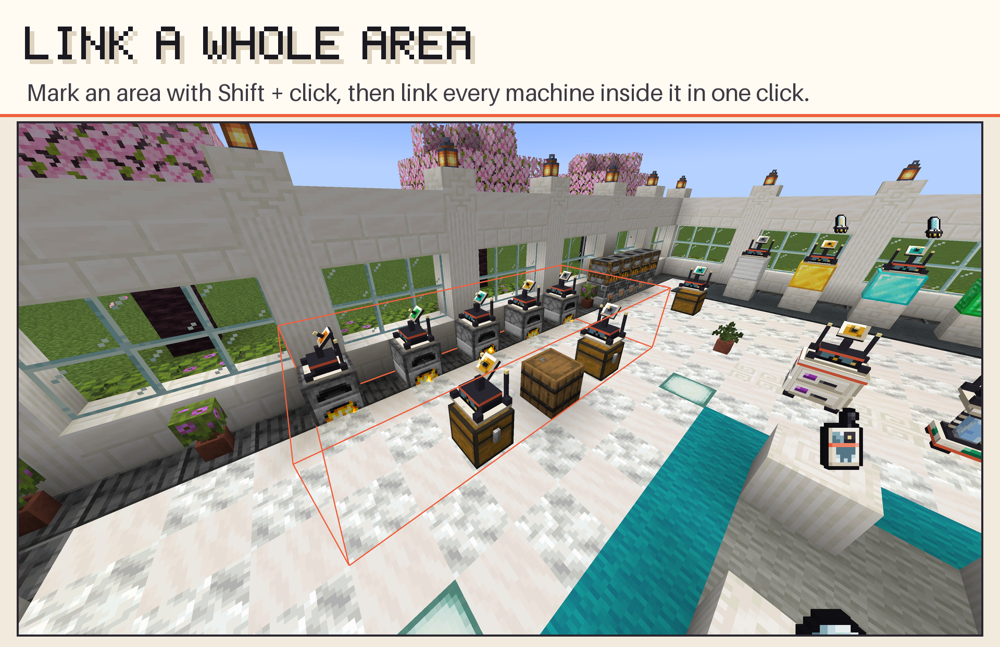

- **Vinculador** (dois modos): **Vincular** escolhe um roteador com o Upgrade de Alcance (clique nele) e vincula as máquinas em que você clica, ou **uma área marcada inteira** de uma vez (Shift + clique em dois blocos; a mais perto primeiro, até o raio e o limite do tier); a chave **Desvincular** tira em vez de pôr. **Abrir** abre a tela do roteador que chega na máquina em que você clica, já editando aquela máquina; com vários roteadores, uma lista curta deixa você escolher. Ele confere o alcance, os claims e os mods de proteção no roteador. O Vinculador não mexe mais em redes: escolha a rede de cada face na tela do roteador ou no Tablet.
- **Configurador** (o Pincel): Shift + clique num roteador copia a configuração dele (faces, filtros, prioridades, redstone e a rede de cada face), clique cola em outro, e Shift + clique num bloco sem roteador limpa a cópia. Cole todas as abas ou só um tipo, sem tocar nas outras abas. Segure **Alt esquerdo** para uma roda radial que escolhe o tipo colado. A rede de uma face só é colada se você puder usá-la, e uma face só sai de uma rede que você edita. Para configurar vários roteadores de uma vez, cole o perfil nos marcados do Tablet.
- **Upgrade de Chunk Loading:** mantém um roteador e a máquina dele trabalhando enquanto você está longe.
- **Editor de receitas** (operadores): `/wa recipes` abre uma tela para trocar, desativar ou restaurar qualquer receita de bancada do mod, com itens do seu inventário ou do JEI, tags e a quantidade do resultado. Gravado como datapack em `config/wirelessautomate/recipes/`, então vale em todos os mundos e sobrevive a atualizações. Útil para packs que querem outra receita do Ultimate.

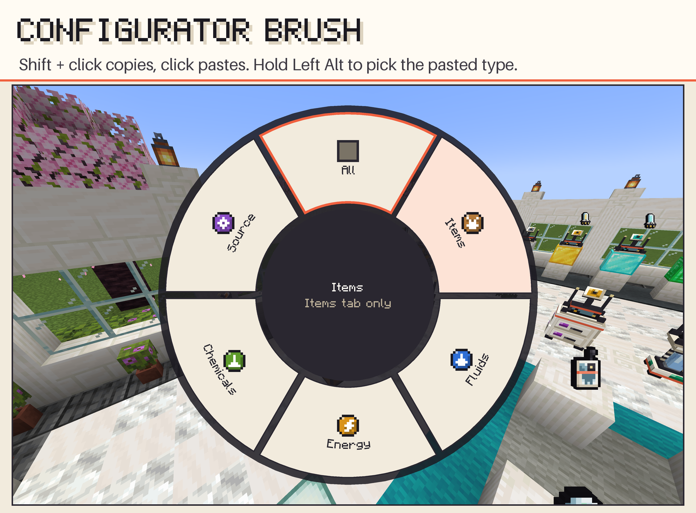

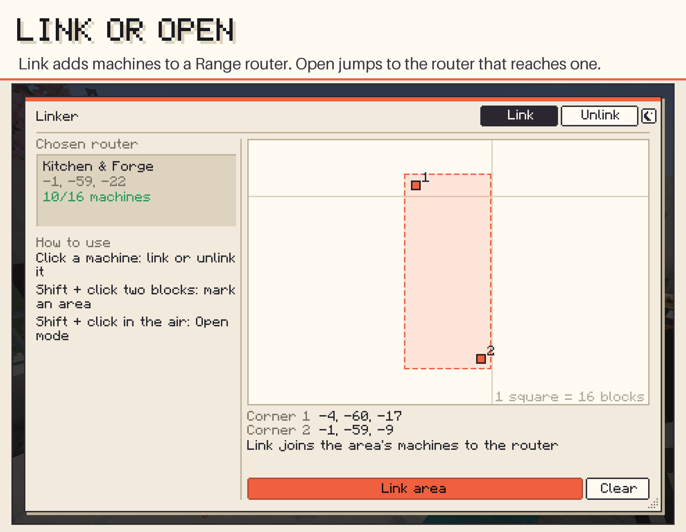

### Tablet de Rede

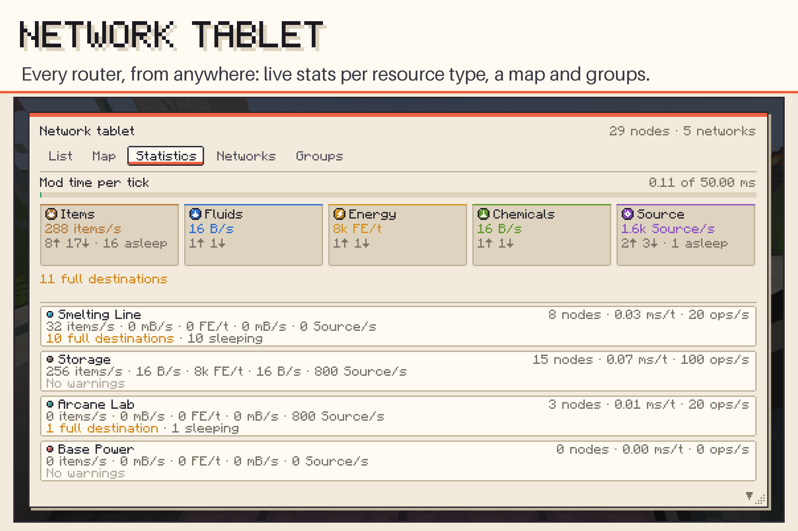

Todos os roteadores de todas as redes, de qualquer lugar: uma caixa de busca para máquina, rede e nome, filtros rápidos e uma linha por roteador (tier, nome e a máquina em que ele está), com o nó escolhido **editável ali mesmo** (as faces desdobradas como um cubo, o mesmo painel da tela do roteador). Renomeie um roteador ou a máquina dele com ✎ direto na lista. Abra um roteador na lista para ver cada máquina vinculada com o estado dela, ou troque para **Máquinas** para ver todas as máquinas da base pelo tipo de bloco. Copie o perfil de um nó e cole em roteadores, em máquinas soltas ou em grupos de máquinas inteiros, com desfazer. Tem também um **mapa visto de cima que você arrasta** e mostra todos os roteadores que você vê (use **Centralizar** para voltar a você), uma aba **Fluxos** com o que entra e sai de cada tipo e rede, os saldos dos Armazéns e o que precisa de atenção (clique numa linha para filtrar a lista), os roteadores com faces em várias redes, e grupos de redes para pausar e retomar um sistema inteiro de uma vez. O mapa mostra as máquinas do roteador escolhido. Dois cliques num nó abrem a tela completa dele à distância.

**Compartilhe uma rede.** Numa rede privada sua, a aba Redes lista os seus **convidados** e, com o FTB Teams, os seus **times**: digite um nome e escolha nas sugestões (jogadores que já entraram no servidor e times de grupo), e clique no ✕ duas vezes para tirar. Convidados usam a rede e editam os nós dela; só você e os operadores a gerenciam. Um time conta como um todo e é ao vivo: quem entra ou sai dele ganha ou perde o acesso sozinho. Também há os comandos `/wa network invite`, `uninvite` e `team add|remove`.

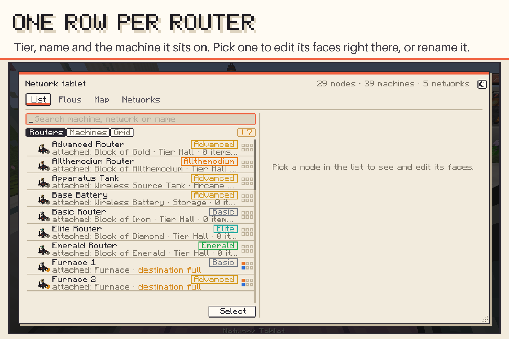

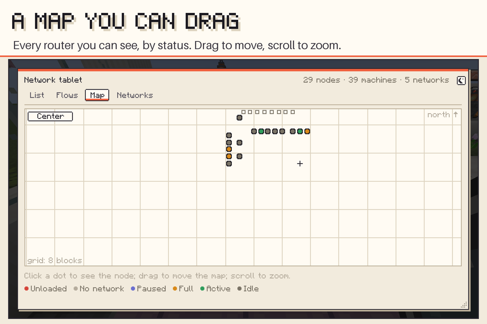

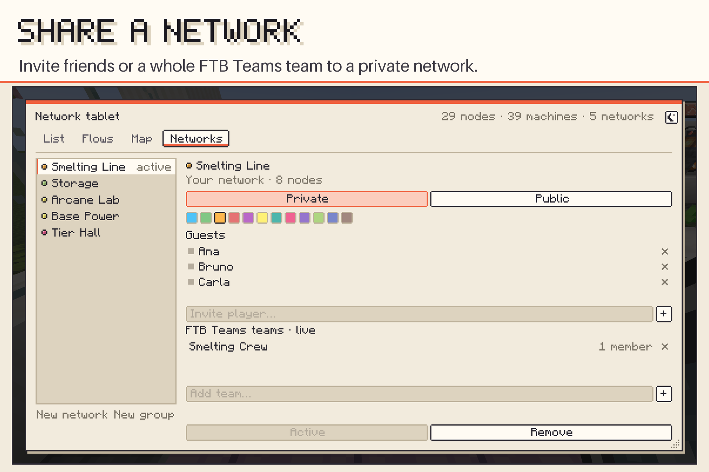

### Livro-guia embutido

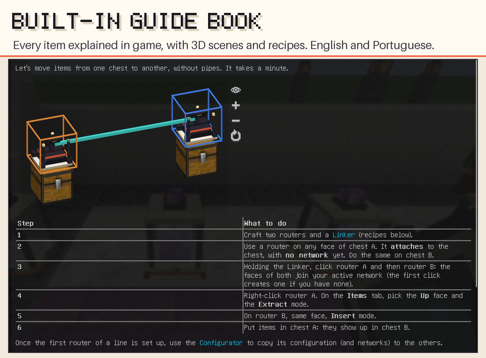

Todo jogador recebe o livro-guia no primeiro login (ele também está na aba criativa, ou faça com um livro e redstone). Ele explica cada item com cenas 3D interativas e receitas, em **inglês e português**. Passe o mouse sobre qualquer item do mod e segure **G** para ir à página dele.

---

## Primeiros passos

1. Faça dois roteadores (ferro, redstone e um olho do ender).
2. Use um num baú e o outro em outro baú. Roteadores novos começam sem rede.
3. Abra o primeiro roteador, escolha a face **Cima** na aba **Itens** e, na linha **Rede**, crie uma rede e escolha-a. Faça o mesmo no segundo roteador, escolhendo a mesma rede.
4. No primeiro roteador, ponha a face **Cima** em **Extrai**.
5. No segundo roteador, ponha a mesma face em **Insere**. Agora os itens vão do primeiro baú para o segundo.

Com o primeiro roteador de uma linha configurado, copie-o com o Configurador (Shift + clique nele) e cole (clique) nos outros.

As receitas usam itens vanilla, menos os tiers do Allthemodium (feitos com os metais do mod Allthemodium, só quando ele está instalado).

---

## Compatibilidade

| Mod | O que traz |
| --- | --- |
| **Qualquer mod com armazenamento padrão do NeoForge** | Itens, fluidos e energia funcionam com qualquer máquina, baú ou tanque que expõe os handlers padrão de item, fluido e energia do NeoForge, o que cobre a maioria dos mods de tecnologia e armazenamento (testado com o Sophisticated Storage e o Mekanism). |
| **Mekanism** (opcional) | Uma aba **Químicos** para gases, tipos de infusão, pigmentos e lamas, e o Tanque Químico Wireless. Lembre de ligar a face na configuração de lados da máquina do Mekanism. |
| **Ars Nouveau** (opcional) | Uma aba **Source** (Source Jars, Relays e a Imbuement Chamber se ligam direto num roteador) e o **Tanque de Source Wireless**, que as máquinas do Ars usam como uma Source Jar. Precisa do Ars Nouveau 5.2 ou mais novo. |
| **Allthemodium** (opcional, como no ATM10) | Três tiers a mais (Allthemodium, Vibranium e Unobtainium) entre a Esmeralda e o Ultimate, para o roteador e todos os armazenamentos. Com o **All The Tweaks**, o anel do Ultimate pede fragmentos de ATM Star. |
| **JEI** (opcional) | Arrastar e soltar (ou Shift + clique) ingredientes nos filtros sem ter o item, ou no inspetor de tags; as receitas de subir tier (bloco no anel, cartões com origem, bloco + cartão) aparecem no JEI. |
| **FTB Teams** (opcional) | Acrescente um time de grupo a uma rede privada e cada membro ganha o acesso de convidado, ao vivo. Precisa do FTB Teams para 1.21.1 (com o FTB Library e o Architectury, que ele mesmo pede). |
| **GuideME** (opcional) | O livro-guia no jogo. |

## Desempenho

- Sem tick por bloco: um gerenciador central por servidor.
- Um orçamento de tempo por tick (1 ms por padrão, configurável) que encolhe sozinho quando o servidor está sofrendo. O trabalho que não cabe continua no tick seguinte; nada se perde.
- Origens vazias e destinos cheios dormem e não custam quase nada.

## Requisitos

- Minecraft **1.21.1**
- **NeoForge** 21.1.248 ou mais novo (funciona no All the Mods 10)

## Código-fonte

O código-fonte está publicado só para consulta (veja Licença abaixo). Relatos de bugs e sugestões são bem-vindos como [issues](https://github.com/MatheusANBS/Wireless-Automate/issues).

### Compilar

```bash
./scripts/setup.sh              # Linux, macOS ou WSL
.\scripts\setup.ps1             # Windows (PowerShell)
```

O script instala o que faltar (JDK 21, git, curl, unzip) e roda o primeiro build, que baixa e decompila o Minecraft (uns 4 minutos). Opções: `--gametest` (`-GameTest`) roda também os GameTests; `--no-build` (`-NoBuild`) só instala as ferramentas.

| Comando | O que faz |
| --- | --- |
| `./gradlew build` | Compila, roda os testes JUnit e gera o jar em `build/libs/` |
| `./gradlew test` | Só os testes JUnit (lógica sem Minecraft) |
| `./gradlew runGameTestServer` | GameTests num servidor sem tela (sem o Mekanism); falha se algum teste falhar |
| `./gradlew runGameTestServerChemicals` | GameTests de químicos, num servidor com o Mekanism |
| `./gradlew runGameTestServerSource` | GameTests de Source, num servidor com o Ars Nouveau (e GeckoLib e Curios) |
| `./gradlew runGameTestServerAllthemodium` | GameTests dos tiers do ATM, com o Allthemodium, o All The Tweaks e o GeckoLib |
| `./gradlew runGameTestServerTeams` | GameTests de times, num servidor com o FTB Teams, o FTB Library e o Architectury |
| `./gradlew runClient` | Cliente de dev com JEI, Mekanism, Ars Nouveau, Allthemodium, GuideME e outros mods, para testar à mão |
| `./gradlew runData` | Geradores de dados, saída em `src/generated/resources/` |
| `./scripts/e2e.sh` | Teste de ponta a ponta num mundo real (ver `docs/e2e.md`) |
| `./scripts/bench.sh <cenários>` | Benchmark num servidor dedicado com Sophisticated Storage (ver `docs/benchmark.md`) |

O CI (`.github/workflows/build.yml`) roda o `build` e as cinco runs de GameTest a cada push e pull request.

### Organização

O mapa do código-fonte fica no [`CLAUDE.md`](CLAUDE.md) ("Mapa do código").

- `docs/especificacao.md`: especificação do mod (fonte da verdade do design).
- `docs/progresso/`: o que está pronto, o que falta, as decisões e o histórico.
- `docs/benchmark.md`: como rodar o benchmark e os resultados.
- `docs/curseforge/`: descrição do CurseForge, changelogs, banner e as imagens e GIFs usados aqui.
- `scripts/`: `setup.sh`/`setup.ps1`, `e2e.sh`, `bench.sh`, `textures/` (gera as texturas), `guide/` (gera as páginas do guia) e `curseforge/` (gera as imagens do CurseForge).

## Licença

All Rights Reserved: o código e os recursos estão aqui para consulta, sem permissão para copiar, modificar ou redistribuir (ver [`LICENSE`](LICENSE)). Para sugestões e bugs, abra uma issue.
