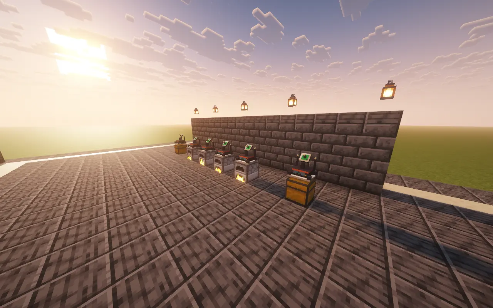
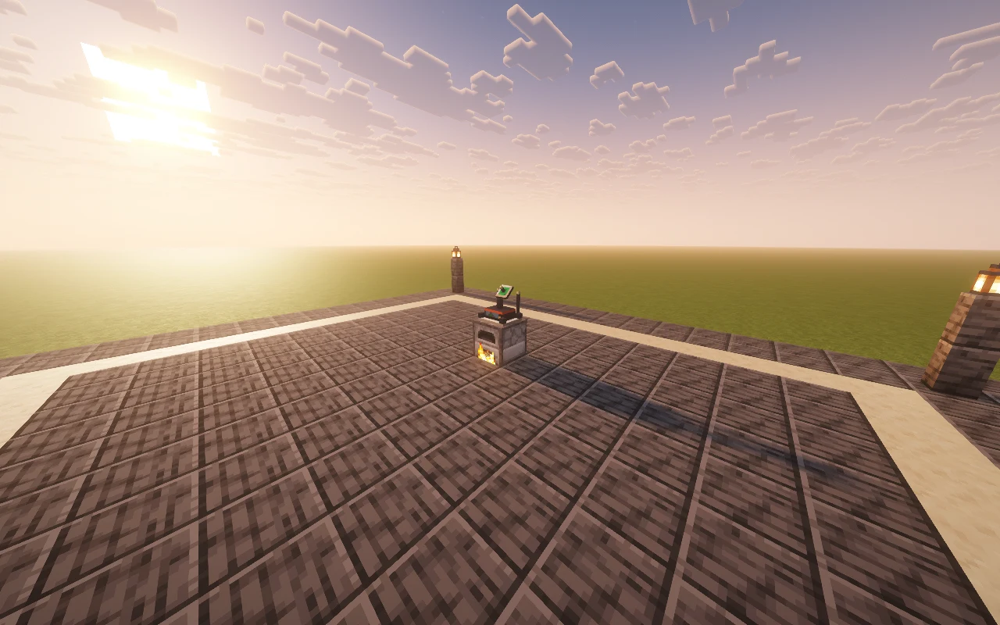
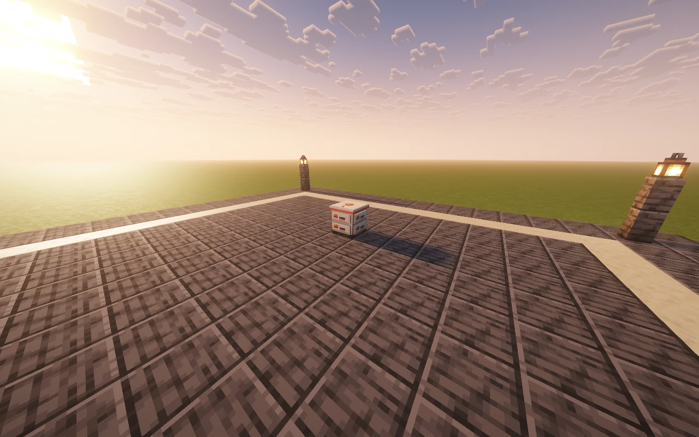
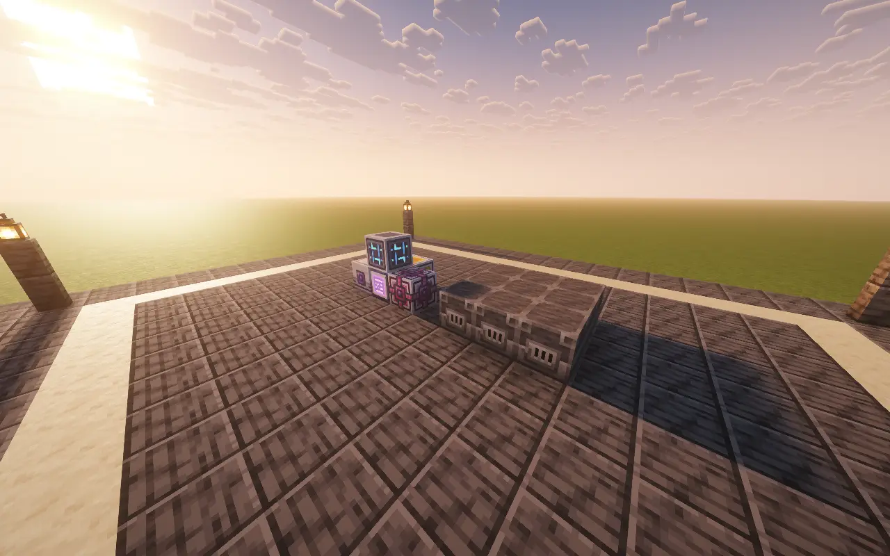
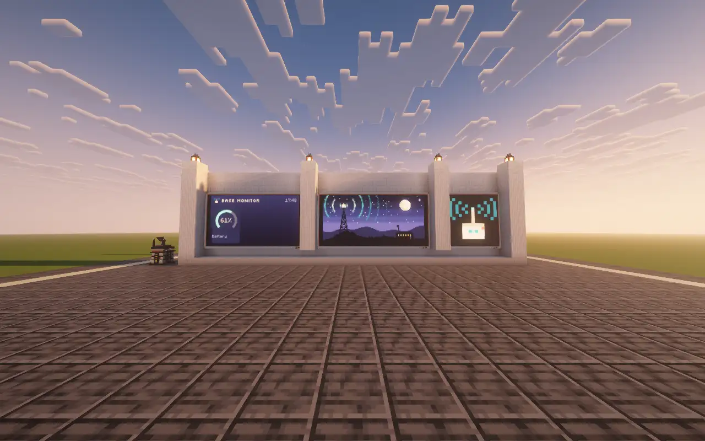
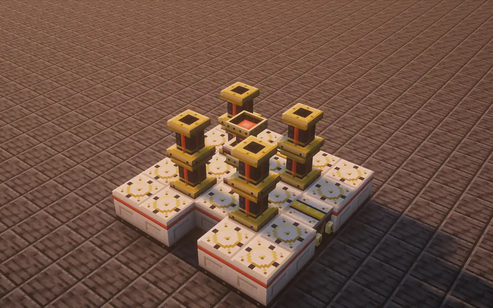
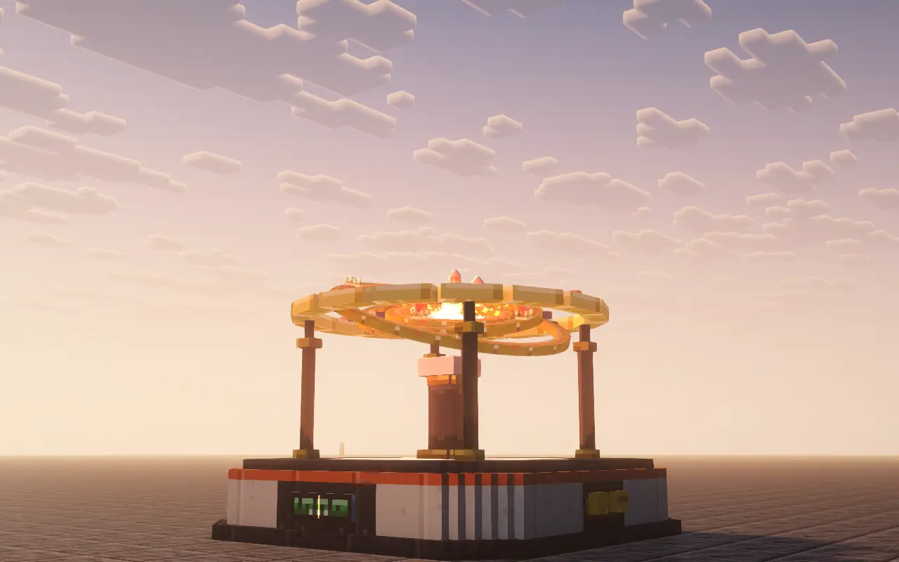
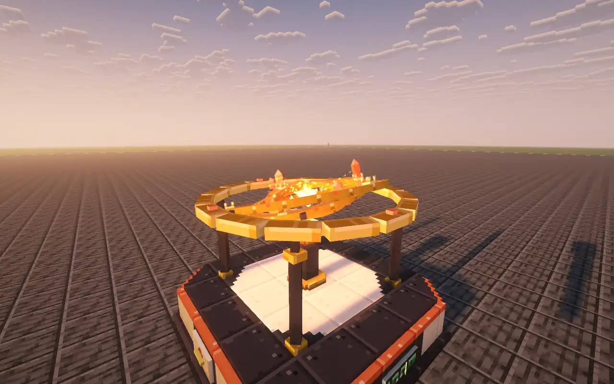
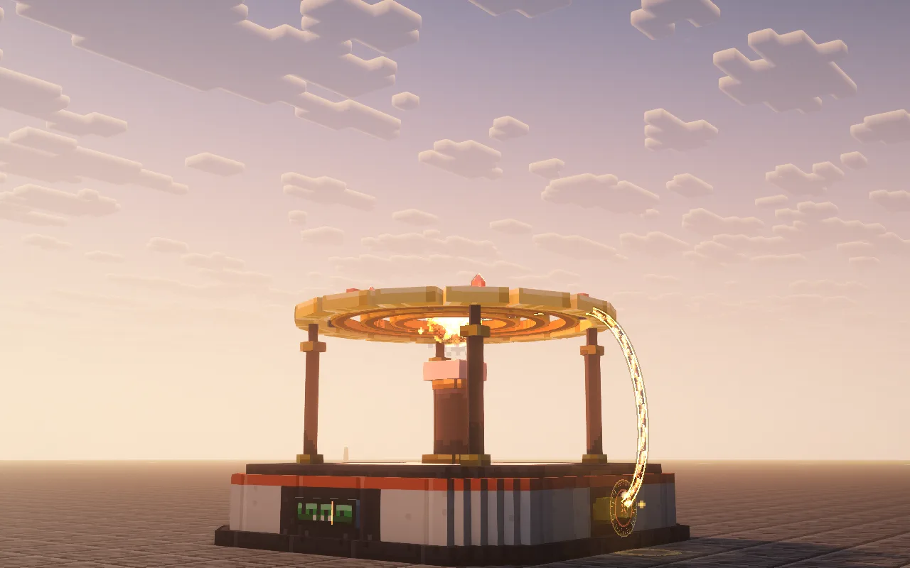

# Wireless Automate

*[Read in English](README.en.md)*

**Move itens, fluidos, energia, químicos do Mekanism e Source do Ars Nouveau entre máquinas, sem canos.**
Prenda um roteador numa máquina, escolha o que cada face faz, e todos os roteadores da mesma rede trocam entre si, perto ou longe, em qualquer dimensão. Feito para modpacks grandes: um gerenciador central com um orçamento de tempo pequeno por tick, então centenas de máquinas não viram lag.

**Versão 2.19:** o Ressonador de Sinal vira a Armilar, gerando a cada tick, com a Porta de Energia que empurra sozinha e sons próprios. O que mudou em cada versão está no [changelog](docs/curseforge/changelog-curseforge-2.19.0.md). Baixe no [CurseForge](https://www.curseforge.com/minecraft/mc-mods/wireless-automate) ou na [release mais recente](https://github.com/MatheusANBS/Wireless-Automate/releases/latest).

---

## Roteadores



- **As seis faces da máquina** numa tela só, por tipo de recurso: Extrair, Inserir, Armazenar ou Nenhum, com prioridade, rodízio e redstone.
- **Uma rede por face:** uma fornalha recebe minério da linha de mineração por cima e manda lingotes para o armazém por baixo.
- **Upgrade de Alcance:** um roteador atende todas as máquinas que você vincula em volta dele, até 128 no Ultimate.

## Filtros



Itens exatos, tags e mods inteiros, lista branca ou negra, com limites de estoque. Um inspetor de tags e **regras** pelo que o item é: qualquer item encantado, ferramentas abaixo de 25% de durabilidade, Fortuna ≥ III.

## Baú Wireless



Tipos de item sem limite e bilhões por operação (12 milhões de itens num tick entre dois deles). Dois slots de upgrade: uma **grade de craft 3×3** que se reabastece do Baú e um **Upgrade de Compactação** que transforma pepitas → lingotes → blocos conforme chegam. Também há Tanque, Bateria e, com os mods opcionais, Tanque de Químicos e Tanque de Source.

## Doca de Padrões (AE2 e Refined Storage 2)



Encoste um Pattern Provider do AE2 ou um Autocrafter do RS2 num lado, vincule as máquinas com o Vinculador, e a Doca entrega **cada pedido inteiro a uma máquina livre**, devolvendo o resultado direto à rede. Itens, fluidos e químicos; até seis linhas de produção por Doca.

## Tela de Sinal



Um painel de parede de 1×1 a 32×32 blocos com **números ao vivo** das suas redes e armazenamentos, um editor completo no jogo, um **editor de pixel art com animação** e os seus próprios arquivos PNG, JPG e GIF.

## Ressonador de Sinal






Um gerador que você sintoniza como um rádio. Monte a **Armilar**, ponha Cristais de Sinal no Núcleo e gire o dial até a estação, que escorrega devagar: em sintonia, o planetário se alinha e a energia sai a cada tick, de 432 FE/t no Básico a **4,29 bilhões de FE/t** no Ultimate. A Porta de Energia empurra para o que estiver encostado. Os cristais se gastam, racham e são consertados no **Reparador de Cristais**.

---

## Tiers

| Tier | Itens/s | Fluidos (mB/s) | Energia (FE/t) | Alcance |
| --- | --- | --- | --- | --- |
| Básico | 32 | 8.000 | 454 | 64 blocos |
| Avançado | 256 | 64.000 | 29.100 | 512 blocos |
| Elite | 2.048 | 512.000 | 63.000 | A dimensão inteira |
| Esmeralda | 16.384 | 4.096.000 | 1.350.000 | Todas as dimensões |
| Ultimate | Sem limite | Sem limite | Sem limite | Todas as dimensões |

Com o **Allthemodium** (ATM10), mais três tiers entram entre o Esmeralda e o Ultimate. Os Cartões de Upgrade sobem um roteador já colocado sem perder a configuração. Todo valor está na config.

## Também tem

**Tablet de Rede** (todos os roteadores de qualquer lugar, com mapa e fluxos ao vivo) · **Vinculador** e **Configurador** para construções grandes · **Upgrade de Chunk Loading** · um **livro guia** com cenas em 3D, em português e inglês · tema claro e escuro em todas as telas.

## Compatibilidade

Funciona com qualquer bloco que exponha os handlers de item, fluido e energia do NeoForge. Opcionais: **Mekanism** (químicos), **Ars Nouveau** (Source), **Allthemodium** (tiers), **AE2** e **Refined Storage 2** (Doca de Padrões), **FTB Teams** (redes compartilhadas), **JEI**.

**Requer** Minecraft 1.21.1 e NeoForge 21.1.248 ou mais novo (funciona no All the Mods 10).

## Código-fonte

O código-fonte está publicado só para consulta (veja Licença abaixo). Relatos de bugs e sugestões são bem-vindos como [issues](https://github.com/MatheusANBS/Wireless-Automate/issues).

### Compilar

```bash
./scripts/setup.sh              # Linux, macOS ou WSL
.\scripts\setup.ps1             # Windows (PowerShell)
```

O script instala o que faltar (JDK 21, git, curl, unzip) e roda o primeiro build, que baixa e decompila o Minecraft (uns 4 minutos). Opções: `--gametest` (`-GameTest`) roda também os GameTests; `--no-build` (`-NoBuild`) só instala as ferramentas.

| Comando | O que faz |
| --- | --- |
| `./gradlew build` | Compila, roda os testes JUnit e gera o jar em `build/libs/` |
| `./gradlew test` | Só os testes JUnit (lógica sem Minecraft) |
| `./gradlew runGameTestServer` | GameTests num servidor sem tela (sem o Mekanism); falha se algum teste falhar |
| `./gradlew runGameTestServerChemicals` | GameTests de químicos, num servidor com o Mekanism |
| `./gradlew runGameTestServerSource` | GameTests de Source, num servidor com o Ars Nouveau (e GeckoLib e Curios) |
| `./gradlew runGameTestServerAllthemodium` | GameTests dos tiers do ATM, com o Allthemodium, o All The Tweaks e o GeckoLib |
| `./gradlew runGameTestServerTeams` | GameTests de times, num servidor com o FTB Teams, o FTB Library e o Architectury |
| `./gradlew runClient` | Cliente de dev com JEI, Mekanism, Ars Nouveau, Allthemodium e outros mods, para testar à mão |
| `./gradlew runData` | Geradores de dados, saída em `src/generated/resources/` |
| `./scripts/e2e.sh` | Teste de ponta a ponta num mundo real (ver `docs/e2e.md`) |
| `./scripts/bench.sh <cenários>` | Benchmark num servidor dedicado com Sophisticated Storage (ver `docs/benchmark.md`) |

O CI (`.github/workflows/build.yml`) roda o `build` e as cinco runs de GameTest a cada push e pull request.

### Organização

O mapa do código-fonte fica no [`CLAUDE.md`](CLAUDE.md) ("Mapa do código").

- `docs/especificacao.md`: especificação do mod (fonte da verdade do design).
- `docs/progresso/`: o que está pronto, o que falta, as decisões e o histórico.
- `docs/benchmark.md`: como rodar o benchmark e os resultados.
- `docs/curseforge/`: descrição do CurseForge, changelogs e os GIFs usados aqui.
- `scripts/`: `setup.sh`/`setup.ps1`, `e2e.sh`, `bench.sh`, `textures/` (gera as texturas), `guide/` (gera as páginas do guia) e `curseforge/` (monta os GIFs do CurseForge).

## Licença

All Rights Reserved: o código e os recursos estão aqui para consulta, sem permissão para copiar, modificar ou redistribuir (ver [`LICENSE`](LICENSE)). Para sugestões e bugs, abra uma issue.
