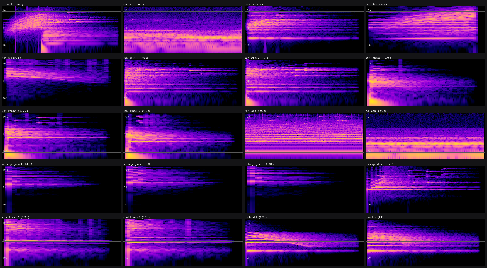

# Sons da Armilar: medidas

Gerado por `scripts/sounds/gerar.py` (síntese própria; motor em `dsp.py`, desenhos em `armilar.py`). Os números são do `.ogg` final, decodificado: pico de amostra, LUFS integrado (`ffmpeg ebur128`; os grãos são curtos demais para o LUFS) e, nos loops, o salto da emenda (do fim para o começo) ao lado do salto típico entre duas amostras (percentil 99,9 dentro do arquivo).

| arquivo | dur s | pico dBFS | LUFS | KB | loop | emenda / típico |
| --- | --- | --- | --- | --- | --- | --- |
| assemble | 3,01 | -4,0 | -18,2 | 38,3 |  |  |
| sun_loop | 8,00 | -19,1 | -31,7 | 88,7 | sim | 0,0027 / 0,0054 |
| tune_lock | 1,64 | -5,4 | -19,6 | 23,2 |  |  |
| conj_charge | 0,62 | -6,2 | -19,2 | 11,3 |  |  |
| conj_arc | 0,62 | -6,0 | -22,5 | 14,3 |  |  |
| conj_burst_1 | 1,83 | -3,0 | -23,2 | 23,6 |  |  |
| conj_burst_2 | 1,61 | -3,9 | -18,3 | 22,5 |  |  |
| conj_impact_1 | 0,78 | -4,1 | -25,2 | 12,2 |  |  |
| conj_impact_2 | 0,76 | -4,1 | -26,5 | 12,2 |  |  |
| conj_impact_3 | 0,76 | -4,0 | -25,4 | 13,0 |  |  |
| flow_loop | 6,00 | -17,8 | -31,6 | 80,7 | sim | 0,0006 / 0,0433 |
| full_loop | 8,00 | -22,3 | -34,0 | 86,4 | sim | 0,0002 / 0,0031 |
| recharge_grain_1 | 0,40 | -8,9 | n/d | 8,4 |  |  |
| recharge_grain_2 | 0,40 | -9,0 | n/d | 9,0 |  |  |
| recharge_grain_3 | 0,40 | -9,1 | n/d | 8,5 |  |  |
| recharge_done | 1,87 | -5,0 | -18,4 | 26,4 |  |  |
| crystal_crack_1 | 0,58 | -5,4 | -24,0 | 11,7 |  |  |
| crystal_crack_2 | 0,61 | -4,8 | -21,7 | 12,0 |  |  |
| crystal_dull | 1,62 | -6,9 | -23,7 | 19,8 |  |  |
| tune_lost | 1,45 | -6,5 | -23,2 | 18,3 |  |  |

Folha de espectros (40 Hz a 20 kHz em log, 90 dB de faixa):

