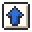
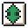
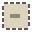

---
navigation:
  title: Wireless Router
  icon: wirelessautomate:router
  parent: index.md
  position: 2
item_ids:
  - wirelessautomate:router
---

# Wireless Router

<BlockImage id="wirelessautomate:router" p:facing="up" p:tier="basic" scale="3" float="left" />

Attach the router to a machine and the machine joins the network through **all six faces at once**.
No pipes.

 

## How to use it

1. Place the router on any face of the machine. Any face works: it reaches all six.
2. Right-click the router to open its screen.
3. Pick the type tab: Items, Fluids or Energy (Chemicals with Mekanism, Source with Ars Nouveau).
4. Click a machine face, on the 3D model or on the panel's cube.
5. Click the face's button until it shows the mode you want.
6. On the **Network** row, pick the face's [network](networks.md).

Done: the face now trades resources with the other faces on the same network.

## Recipe

<RecipeFor id="wirelessautomate:router" />

## Where to attach it

<GameScene zoom="4" interactive={true}>
  <Block id="minecraft:furnace" x="0" y="0" z="0" />
  <Block id="wirelessautomate:router" x="0" y="1" z="0" p:facing="up" p:tier="basic" />
  <Block id="wirelessautomate:router" x="0" y="0" z="1" p:facing="south" p:tier="basic" />
  <BlockAnnotation x="0" y="1" z="0" color="#4a8cff">
    Attached on top of the furnace
  </BlockAnnotation>
  <BlockAnnotation x="0" y="0" z="1" color="#ff9a3c">
    Attached to the side: works the same
  </BlockAnnotation>
  <IsometricCamera yaw="200" pitch="30" />
</GameScene>

Breaking the block behind it drops the router. Shift + right-click with an empty hand turns the
router; the faces keep their settings.

## Face modes

| Mode | What it does | Use it on |
| --- | --- | --- |
|  **Extract** | Takes out of the machine. | Outputs: furnace, generator, miner. |
|  **Insert** | Puts into the machine. | Inputs: furnace, machine, final chest. |
|  **Storage** | Receives from extractors and delivers to inserters. Doesn't trade with another Storage. | Stock chests. |
|  **None** | The face is left out. | Everything else. |

## On the screen

| Gesture | What it does |
| --- | --- |
| **Click** the face's button | Next mode. |
| **Right-click** | Previous mode. |
| **Shift + click** | Sets None. |
| **Drag** the 3D model | Turns the machine. |
| **Drag** the edge or corner | Makes the screen bigger. |
| **Copy** and **Paste** | Copies everything from one face to another of the same type. |
| **Clear** (two clicks) | Sets the tab's faces to None. With Shift on the second click, every tab. |

The sides (Front, Back, Left, Right, Top, Bottom) are the machine's, as seen facing it. A machine
without a front, like a barrel: Front = North.

## Face settings

| Setting | How it works |
| --- | --- |
| **Priority** | From −999 to 999 (default 0). Higher receives first; ties take turns. Hold Shift to step by 10. |
| **Redstone** | Ignore (default), With signal or No signal on the router. |
| **Filter** | **Edit** opens the face's [filter](filters.md). Next to it, two slots for [Filter Cards](filter-card.md). |

## Upgrades

- [Upgrade Cards](upgrade-cards.md): Shift + use on the router. More throughput and range.
- [Chunk Loading Upgrade](chunk-loading.md): in the slot at the top of the screen. The router keeps
  working while you're away.
- **Range Upgrade:** the router serves several machines around it. Their list sits under the viewer:
  ✎ names a machine and the eye ◉ lights it up in the world.

## Throughput per tier

<Row gap="12">
  <ItemImage id="wirelessautomate:router" scale="2" components="minecraft:block_state={tier:'basic'}" />
  <ItemImage id="wirelessautomate:router" scale="2" components="minecraft:block_state={tier:'advanced'}" />
  <ItemImage id="wirelessautomate:router" scale="2" components="minecraft:block_state={tier:'elite'}" />
  <ItemImage id="wirelessautomate:router" scale="2" components="minecraft:block_state={tier:'emerald'}" />
  <ItemImage id="wirelessautomate:router" scale="2" components="minecraft:block_state={tier:'ultimate'}" />
</Row>

Throughput is **per face and per type**. Chemicals use the fluid limit. Your server may change these
numbers: the upgrade card's tooltip shows its values.

| Tier | Items/s | Fluid and chemical (mB/s) | Energy (FE/t) | Source/s | Range |
| --- | --- | --- | --- | --- | --- |
| **Basic** | 32 | 2,000 | 454 | 100 | 64 blocks |
| **Advanced** | 256 | 16,000 | 29,100 | 800 | 512 blocks |
| **Elite** | 2,048 | 128,000 | 63,000 | 6,400 | The whole dimension |
| **Emerald** | 16,384 | 1,024,000 | 1,350,000 | 51,200 | Every dimension |
| **Allthemodium¹** | 131,072 | 8,192,000 | 67,200,000 | 409,600 | Every dimension |
| **Vibranium¹** | 1,048,576 | 65,536,000 | 84,500,000 | 3,276,800 | Every dimension |
| **Unobtainium¹** | 8,388,608 | 524,288,000 | 158,000,000 | 26,214,400 | Every dimension |
| **Ultimate** | Unlimited | Unlimited | Unlimited | Unlimited | Every dimension |

¹ Only with the Allthemodium mod. Source only with Ars Nouveau.

<GameScene zoom="3" interactive={true}>
  <Block id="minecraft:chest" x="0" y="0" z="0" />
  <Block id="wirelessautomate:router" x="0" y="1" z="0" p:facing="up" p:tier="basic" />
  <Block id="minecraft:furnace" x="2" y="0" z="0" />
  <Block id="wirelessautomate:router" x="2" y="1" z="0" p:facing="up" p:tier="advanced" />
  <Block id="minecraft:barrel" x="4" y="0" z="0" p:facing="up" />
  <Block id="wirelessautomate:router" x="4" y="1" z="0" p:facing="up" p:tier="elite" />
  <Block id="minecraft:smoker" x="6" y="0" z="0" />
  <Block id="wirelessautomate:router" x="6" y="1" z="0" p:facing="up" p:tier="emerald" />
  <Block id="minecraft:blast_furnace" x="8" y="0" z="0" />
  <Block id="wirelessautomate:router" x="8" y="1" z="0" p:facing="up" p:tier="ultimate" />
  <BlockAnnotation x="0" y="1" z="0" color="#c8ccd2">
    Basic
  </BlockAnnotation>
  <BlockAnnotation x="2" y="1" z="0" color="#e2b347">
    Advanced
  </BlockAnnotation>
  <BlockAnnotation x="4" y="1" z="0" color="#45d6cc">
    Elite
  </BlockAnnotation>
  <BlockAnnotation x="6" y="1" z="0" color="#2fdc62">
    Emerald
  </BlockAnnotation>
  <BlockAnnotation x="8" y="1" z="0" color="#a06bff">
    Ultimate
  </BlockAnnotation>
  <IsometricCamera yaw="200" pitch="30" />
</GameScene>

In creative, middle-click picks the router in the block's tier.
